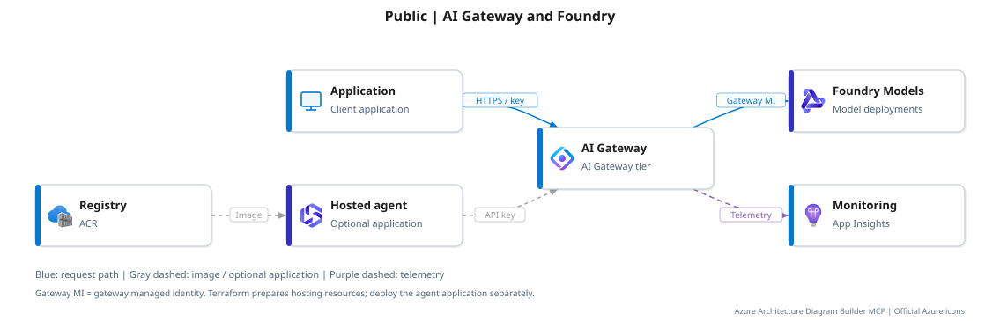
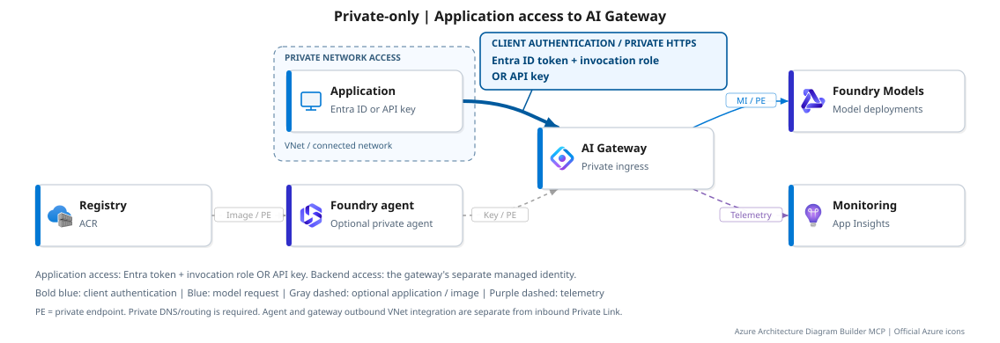

# AI Gateway and Foundry with Terraform

Deploy AI Gateway, Foundry model deployments and infrastructure for a separately
deployed hosted agent. The gateway handles access and policy; the model generates
the answer. This is standalone Terraform, not an `azd` application.

## Two networking options

| Configuration | Gateway public access | Model public access |
| --- | --- | --- |
| **Public** (default) | Enabled | Enabled |
| **Private-only** | Disabled | Disabled |

### Public

Clients call the gateway with an API key; the gateway authorizes to Foundry Models
using its managed identity. Agent hosting resources are provisioned, but the
container image and agent application are deployed separately.

### Private-only

Private endpoints (PE), DNS and outbound VNet integration connect the private
request path. The optional private agent requires creation-time network injection
and a later application deployment/runtime-role binding. It is part of
Private-only, not a third networking option.

These are logical flows, not subnet-placement diagrams. The Foundry inbound PE,
agent outbound injection, gateway inbound PE and gateway outbound integration are
separate controls. Identity, control-plane and telemetry traffic are not claimed
to be fully private. Registry/Storage and monitoring are supporting resources,
not extra model-serving hops; registry public access is unchanged by the agent extension.

## Deploy

Follow the **[deployment guide](docs/deployment.md)** for prerequisites, inputs,
monitoring bootstrap, the chosen network path, private-agent setup and acceptance.
Keep the selected private profile on all later plans. The retained
`private-connectivity` profile is only an intermediate provisioning stage.

Review preview support, policies, regional availability and costs before applying.
The sample retains the `Microsoft.ApiManagement/service` / `AIGateway` contract;
check its compatibility with your environment. Supporting resources and model
calls incur charges; the gateway preview has no SLA.

| File | Purpose |
| --- | --- |
| [terraform.tfvars.example](terraform.tfvars.example) | Starting inputs for a new environment |
| [variables.tf](variables.tf) / [outputs.tf](outputs.tf) | Complete input and output contract |
| [profiles/private-only.tfvars.json](profiles/private-only.tfvars.json) | Final private gateway/model posture |
| [scripts](scripts) / [tests](tests) | Deployment checks and offline regression tests |

Diagrams generated with Azure Architecture Diagram Builder MCP; specialized
service icons corrected in the SVG export using the
[official Azure icon set](https://learn.microsoft.com/azure/architecture/icons/).
