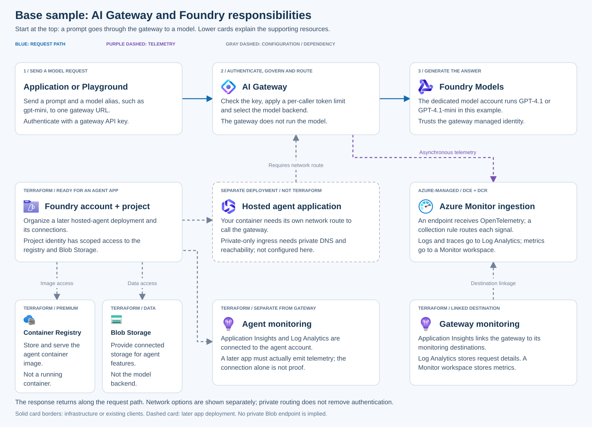
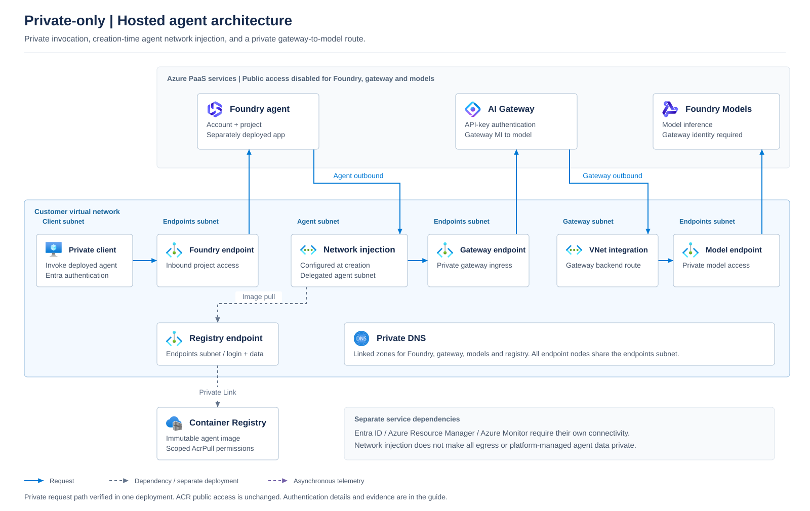

# AI Gateway and Foundry with Terraform

Manage an Azure AI Gateway that routes calls to Foundry models. This is standalone
Terraform for the [Foundry AI Gateway Python sample](https://github.com/Azure-Samples/simple-foundry-hosted-agent-python-aigateway), not an `azd` app.

> **Preview PoC, not production.** The AI Gateway preview has **no SLA**. Everything
> here is billable (model calls, Premium ACR, Storage, monitoring). Read the
> [limitations](docs/reference.md#limitations) before applying.

> **Existing deployments only.** This sample retains the legacy
> `Microsoft.ApiManagement/service` resource with SKU `AIGateway`. New gateways
> cannot be created with that SKU, and existing ones must migrate before
> **January 15, 2027**. This sample does not perform that migration.
> See [resource type and lifecycle](docs/reference.md#resource-type-and-lifecycle).

## Choose your networking path

The sample includes **both public and private connectivity**. The public path is
the Terraform default. Two explicit private-network profiles preserve the choice
between hybrid ingress and a private-only gateway end state.

| Path | Private endpoints | Gateway public access | Model public access |
| --- | --- | --- | --- |
| [Private connectivity / hybrid ingress](#private-connectivity-path) | Gateway and model account | **Enabled** | **Disabled** after staging |
| [Private-only gateway ingress](docs/private-connectivity.md#optional-final-stage-disable-gateway-public-access) | Gateway and model account | **Disabled** after private-route verification | **Disabled** |
| [Public endpoints](#public-endpoint-path) | None | Enabled | Enabled |

**Update, October 25, 2026:** disabling public ingress through the portal succeeded
for the observed gateway after a long wait; ARM confirmed `Disabled` / `Succeeded`
and an `Approved` / `Succeeded` private connection. The previous configuration
blocker is resolved **for that gateway**, not a confirmed universal product fix
or a proven Terraform update. A subsequent private hosted-agent invocation
returned **OK**, with gateway and model-backend **HTTP 200** in the same trace;
an authenticated public gateway request returned an explicit network-denial
**HTTP 403**. The final Terraform plan had no changes.
See [evidence and verification boundaries](docs/reference.md#private-only-gateway-ingress-status).

**Already using the private profile?** Follow [existing private deployments](docs/private-connectivity.md#existing-private-deployments).
Keep the **selected** profile on every plan, including drift and monitoring
changes. Do not repeat temporary-public staging for an already-private gateway
or backend.

## Before you start

**Check these first:**

- [ ] Terraform 1.11+ (below 2.0) and Azure CLI installed
- [ ] Existing legacy AIGateway deployment and subscription access to Foundry hosted agents in your regions
- [ ] Permission to create resources and role assignments (for example, Contributor plus Role Based Access Control Administrator)
- [ ] If enabling the test VM: permission to manage its **custom role definition**, not just role assignments; see [test-client permissions](docs/private-connectivity.md#test-client-permissions)
- [ ] Providers registered: `Microsoft.ApiManagement`, `Microsoft.Web`, `Microsoft.CognitiveServices`, `Microsoft.Storage`, `Microsoft.ContainerRegistry`, `Microsoft.OperationalInsights`, `Microsoft.Insights`, `Microsoft.Monitor` (this sample does not register them for you)
- [ ] Quota for the model and SKU in your region

**Decide before you start:**

- **Public endpoints OK?** If your policy prohibits public gateway or model endpoints, even temporarily, do not run this sample unchanged.
- **Need private hosted-agent execution?** Enable the [private hosted-agent configuration](docs/private-hosted-agent.md) from the start for the new agent account. Terraform creates network injection, private endpoints and project dependencies; deploy the application and bind its actual runtime identity afterward. This reference path has passed a live test; it is not enabled by default.
- **Need private-only gateway ingress?** Select the explicit private-only end-state profile after endpoint approval and private-route verification. Portal disable and subsequent private agent inference are proven for one gateway; first-create/Terraform update behavior remains a separate boundary. See the [status](docs/reference.md#private-only-gateway-ingress-status).

### Platform team: policy compatibility

Before deployment, review the effective Azure Policy assignments at the target
scope, including inherited management-group and subscription assignments,
initiative parameters, exclusions and applicable exemptions. Compare them with
the resources and settings in your selected deployment path.

| Check | Required outcome before apply |
| --- | --- |
| Allowed regions, resource types, SKUs and mandatory tags | All planned resources comply, including Azure-managed monitoring helper resources. |
| Public network access for the gateway, model account, Storage and Container Registry | The selected path meets your requirements, including any temporary access used during staged deployment. |
| Private endpoints, DNS, routing and outbound restrictions | Deployment clients and each runtime identity have a supported network path to the services they need; disabling public access alone does not provide that path. |
| Identity, authentication and RBAC requirements | Deployment permissions, managed identities, role assignments and the gateway's runtime API-key authentication are compatible with your controls. |
| Monitoring and security requirements | Required diagnostics, retention and destinations are accounted for, along with any automatically enabled Defender plans and their costs. |

Resolve incompatibilities in the IaC and deployment inputs **before apply**.
For example, if your policies require private Storage access, provide or reuse
the necessary private endpoint, DNS and connectivity for every client that
needs Storage. This is a conditional requirement, not a prerequisite for every
customer. Do not disable policies or reopen restricted endpoints to make the
sample deploy.

A successful `terraform plan` is **not** proof of policy compatibility:
`Deny` can block resource creation, `Modify` can change requested settings, and
`DeployIfNotExists` can deploy related resources. After deployment and any policy
remediation, inspect the actual configuration, run a fresh plan with the same
inputs, and verify DNS, connectivity, authentication and telemetry from the
intended clients. Investigate policy-induced drift rather than blindly applying
a plan that would undo an enforced setting.

## What gets deployed

Start with a single request: **your app sends a prompt to the gateway; the
gateway checks access and policy; the selected Foundry model generates the
answer.** The supporting resources below prepare a later agent application
and make requests observable.



| Component | Why you need it in this sample |
| --- | --- |
| **AI Gateway** | One model API endpoint for clients. It checks the runtime API key, applies a token limit per caller, resolves the model alias and forwards the request. It does not run the model or agent code. |
| **Foundry model account** | Runs the actual model deployments. It trusts the gateway's managed identity, not the client's gateway API key. |
| **Foundry hosted-agent account and project** | Provide the environment, connections and project permissions for a *later* agent application. **No agent, image or running container is deployed by Terraform.** |
| **Container Registry and Blob Storage** | Store a later agent's container image and provide connected data storage. They are not extra model-serving hops and are not prerequisites for a simple client to call the gateway. |
| **Monitoring** | Application Insights links the destinations; Log Analytics stores logs and traces; a separate Azure Monitor workspace stores metrics. Azure-managed collection endpoints and rules ingest and route gateway telemetry. |
| **Private network (private path)** | A gateway private endpoint serves private clients; outbound VNet integration and a separate model private endpoint connect the gateway to the private model backend. DNS makes the private routes usable. |
| **Optional private test VM** | Tests DNS, routing and inference from inside the VNet. It is a probe, not the agent runtime; an existing suitable private client can replace it. |

See the [service-by-service architecture guide](docs/architecture.md) for
the **base private-network diagram**, **private-agent reference** and separate
**current versus future Entra authentication sequences**. Caller-to-gateway
authentication still uses API keys; Entra-only caller authentication is a target,
not an already deployed feature.
Blue arrows are requests, purple
dashed arrows are telemetry, and gray dashed arrows are configuration or a later
deployment. A configured connection is not proof of runtime traffic.

Both paths manage all three core components. Hosted-agent infrastructure is
included even if you only test model calls.

### Private agent reference for new deployments



Use `enable_private_networking = true`, `enable_private_hosted_agent = true`
and the selected private-only ingress profile. These inputs create the agent
account with its required network configuration **at creation time**; they do
not deploy the application. The subsequent application deployment and scoped
runtime-role binding complete the reference setup. The public defaults remain
unchanged, and this does not enable creation of a new legacy AIGateway SKU.

The [private-agent operating guide](docs/private-hosted-agent.md) covers
deployment stages, permanent versus temporary roles, repeat checks and the
local synthetic cases (prepared, not executed). Its Basic setup uses
platform-managed agent data; it does not require the base sample's Blob
connection for the demonstrated model call.

### Shared resource and authentication boundaries

All application resources use **one shared resource group**:
`rg-<environment_name>-<resource_token>-gateway`. The existing gateway group name
and Terraform address are retained; the AIGateway SKU, private-network design and
agent monitoring are unchanged. Gateway OTLP enablement can create **Azure-managed
monitoring helper groups**, with one gateway publishing role on the linked DCR.
This explicit exception, its costs and the required two-stage setup are covered
in [gateway monitoring](docs/monitoring.md).

**Upgrading from the former three-group layout is a migration, not a harmless
refactor.** Terraform can propose backend replacements and deletion of the old
groups. Do not apply until the exact migration/recreation and any data loss have
been approved. See [single-group consolidation](docs/reference.md#single-group-consolidation).

**Authentication in both paths** (independent of public or private routing):

```text
Client --(runtime API key)--> AI Gateway --(managed identity)--> Foundry model account
```

A **model alias** (for example, `gpt-mini`) is the name clients send. It does not have to match the underlying model name (for example, `gpt-4.1-mini`).

## Shared setup

Run from `samples/terraform` for either networking path. Use the existing
deployment's input file and Terraform state/backend. Do not start with an empty
state for resources already managed by this sample.

**1. Sign in:**

```powershell
az login
```

**2. Review the existing `terraform.tfvars`:**

| Setting | What to set |
| --- | --- |
| `subscription_id` | Where resources are created |
| `environment_name` | Existing deployment label; changing it changes resource names |
| `location`, `gateway_location` | Foundry and gateway regions (independent of each other) |
| `publisher_email` | Gateway publisher contact |
| `model_deployments` | Model versions, capacity and token limits. Keys (`gpt-mini`, `gpt-full`) become client-facing aliases. |
| `storage_public_network_access` | `Disabled` only if your policy requires it |

This file is git-ignored. Do not overwrite it with
[terraform.tfvars.example](terraform.tfvars.example), which documents the input
shape only. Optional settings are in the [input reference](docs/reference.md#inputs).

**3. Initialize and check:**

```powershell
az account set --subscription "<subscription-id>"
terraform init
terraform fmt -check -recursive
terraform validate
```

**4. Bootstrap or upgrade gateway monitoring:** follow
[gateway monitoring](docs/monitoring.md) to enable the existing Insights
destination and verify its actual endpoints before the exporter/role plan.
Preserve your networking profile and review each saved plan. This adds
service-managed resources and is not a cost-free or fully reversible toggle.

Then continue with **one** of the networking paths below.

## Private connectivity path

Use [profiles/private-connectivity.tfvars.json](profiles/private-connectivity.tfvars.json)
for private client-to-gateway and gateway-to-model traffic:

```text
Private client -> gateway private endpoint -> gateway outbound VNet integration -> model private endpoint
```

Follow the [private-connectivity guide](docs/private-connectivity.md) for the
staged plan/apply, private probe, and VM lifecycle. This hybrid profile keeps
gateway public access enabled. For a private-only gateway end state, select
[profiles/private-only.tfvars.json](profiles/private-only.tfvars.json) at the
guide's optional final stage. Both profiles disable model public access.

**Do not run the public-path plan below for this configuration.** Omitting the
selected profile can plan removal of private networking or re-enable public
access, depending on your other inputs. The hybrid profile explicitly sets
gateway ingress to `Enabled`; never reuse it for an already-disabled gateway.

## Public endpoint path

Use this path only for a deployment intentionally configured without private
networking. It is not a prerequisite for the private path.

**1. Plan and review:**

```powershell
terraform plan "-out=deployment.tfplan"
```

Stop if planning fails. Review the plan for public access, resource creation and
cost. Do not apply unexpected changes.

**2. Apply the reviewed plan:**

```powershell
terraform apply "deployment.tfplan"
```

**3. Test every alias:**

```powershell
.\scripts\Test-ModelAliases.ps1
```

Each alias should print a short reply, for example `gpt-mini: Hello!`.
This check uses your machine and public endpoints. It does **not** prove private routing.
The example calls every configured alias and assumes chat-completions models,
such as the two models in `terraform.tfvars.example`. Both test scripts reject
missing or incompatible API metadata before making model calls; they do not
silently skip aliases. See [probe compatibility](docs/reference.md#probe-compatibility)
for supported request parameters and updating older outputs. For other model
types, use their supported API and request body instead.

**Done when:** every alias returns a response and `terraform plan -detailed-exitcode` exits `0`.

## Additional runtime checks

For a reproducible private-path rehearsal, use the
[end-to-end runbook](docs/end-to-end.md): credential-free CI, a guarded backend
verifier and a separate authenticated portal review including fresh metrics.
The portal evidence validator checks completeness; it does not automate the UI.

Complete the [customer acceptance guide](docs/acceptance.md) for either path.
It includes commands, expected results, and failure boundaries for missing and
invalid keys, the six service RBAC assignments plus the DCR publishing role, Foundry connections, telemetry,
and the final drift check. A successful model call alone is not full acceptance.

## Going further

- [Reference](docs/reference.md): file guide, all inputs, outputs, networking, state and security, offline tests, limitations
- [Cost and cleanup](docs/reference.md#cost-and-cleanup)
