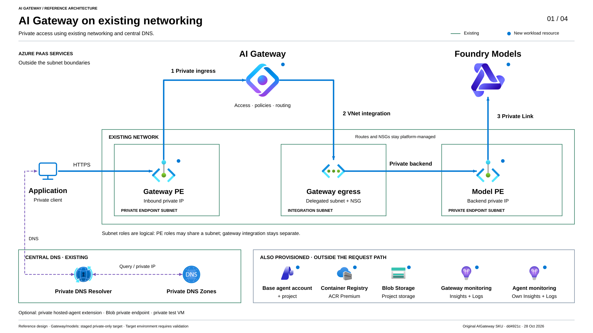

# AI Gateway and Foundry with Terraform

Manage an Azure AI Gateway that routes calls to Foundry models. This is standalone
Terraform for the [Foundry AI Gateway Python sample](https://github.com/Azure-Samples/simple-foundry-hosted-agent-python-aigateway), not an `azd` app.

<a id="start-here-step-by-step-deployment"></a>

## Choose your scenario

**First decide whether the gateway itself is new or already deployed.**
An existing network does not mean an existing gateway. Pick one entry; you do
not need to work through the other scenarios.

| Scenario | Your starting situation | Entry page | Main inputs |
| --- | --- | --- | --- |
| **01** | **New gateway; existing private network and central DNS** | [Reuse existing platform networking](docs/scenarios/01-existing-network.md) | New workload values, approved subnet/zone IDs and DNS-association owner |
| **02** | **New gateway; create a private test network** | [New private lab](docs/scenarios/02-private-lab.md) | New workload values and approved, non-overlapping network ranges |
| **03** | **New gateway; deliberately public test setup** | [New public lab](docs/scenarios/03-public-lab.md) | New workload values and approval for public access |
| **04** | **Gateway already deployed; make an update** | [Update an existing gateway](docs/scenarios/04-update-existing.md) | Existing approved inputs, profiles and authoritative state |

These are **scenario IDs, not an execution order**. The matching prefix on a
scenario guide or filled-example folder identifies its scenario.
**`01-04-` marks material shared across all four scenarios:**

| Shared material | Purpose |
| --- | --- |
| [Generic base template (`01-04-terraform.tfvars.example`)](01-04-terraform.tfvars.example) | Reusable starting point for a new workload. The filled Scenario 01 variant has its own active base example below; choose one source, not both. Retain approved inputs for an existing workload. |
| [01-04-deployment.md](01-04-deployment.md) | Shared runbook; follow only the branch selected by your scenario. |
| [01-04-profiles](01-04-profiles/) | Shared library of network/access choices, not a set to load in full. Your scenario identifies the relevant files and approved stage. |

### Scenario 01: customer reading path

| Read in this order | What you find |
| --- | --- |
| [1. Scenario and file checklist](docs/scenarios/01-existing-network.md#files-for-this-scenario) | Which inputs belong together, what the platform team supplies, and what stays unchanged. |
| [2. Filled input walkthrough](examples/filled/01-existing-network/README.md) | The [active base example](examples/filled/01-existing-network/01-terraform.tfvars.example), complete network JSON, Entra caller access and selected private features. |
| [3. Shared operator procedure](01-04-deployment.md#runbook-order) | Approved input preparation, state and platform handoffs, staged deployment and acceptance. This is the only command sequence. |

The filled variant selects Entra caller roles, private Blob connectivity,
private Hosted Agent infrastructure and a new test VM; these are not defaults
for every Scenario 01 deployment. Its base example and the generic template
are **alternatives**, not extra input layers. Working copies remain protected
inputs such as `terraform.tfvars`; example folders are not separate stacks.

**Just learning?** [Understand the sample without deploying](docs/understand-the-sample.md)
explains the files, their relationships and optional editor help. No terminal,
Azure login or deployment is needed.

Each scenario identifies its files and leads to the
[shared deployment procedure](01-04-deployment.md#runbook-order). The numbered guides
and example folders contain documentation, **not separate Terraform stacks**. This page explains
scope and architecture; the deployment guide owns the command sequence.

## What gets deployed

An application sends a model request to the gateway. The gateway checks access
and policy, then forwards it to a Foundry model deployment. The gateway does
not run the model or the agent application.

| Scope | Resources and purpose |
| --- | --- |
| **Core** | AI Gateway and a Foundry model account provide the model API route. |
| **Core** | A base hosted-agent account/project, Blob Storage and **Premium Container Registry** prepare connections, data and image storage for a later agent application. Terraform deploys **no running agent or container**. |
| **Core** | Application Insights, Log Analytics and a separate Azure Monitor workspace provide the monitoring destinations. Telemetry is separate from the model response. |
| **Private path** | A created or reused network/DNS foundation, new workload private endpoints and gateway outbound VNet integration provide private connectivity. |
| **Optional extension** | Private hosted-agent infrastructure adds another network-configured agent account/project. Choose it before creating that account; application deployment follows separately. |
| **Optional test client** | A sample VM can test private connectivity. An existing suitable private client can be used instead. |

> [!IMPORTANT]
> **This is not a gateway-only stack.** Disabling the private-agent extension
> does not remove the core agent, Storage or Premium Registry resources.
> **Private-only** closes gateway/model public access; it does not make every
> supporting service private.

<a id="shared-resource-and-authentication-boundaries"></a>

Sample-created application resources share one resource group. Reused platform
network/DNS resources keep their own groups and state. Gateway monitoring can
create **Azure-managed helper groups**; see the
[monitoring boundaries and costs](docs/monitoring.md).

> [!NOTE]
> **Legacy contract:** `Microsoft.ApiManagement/service@2025-09-01-preview`,
> SKU `AIGateway`. Microsoft's documented migration deadline is
> **before January 15, 2027**. As of October 25, 2026, the newer
> `Microsoft.ApiManagement/aigateways` resource did not support private
> endpoints. Do not assume feature parity; this sample does not perform the
> migration. See [resource type and lifecycle](docs/reference.md#resource-type-and-lifecycle).

> **Preview PoC, not production; no SLA.** Model calls, Premium Registry,
> Storage and monitoring incur costs, regardless of preview gateway pricing.
> Review [limitations](docs/reference.md#limitations) and
> [cost and cleanup](docs/reference.md#cost-and-cleanup) before applying.

<a id="choose-your-network-foundation"></a>
<a id="choose-a-network-foundation"></a>
<a id="choose-your-networking-path"></a>
<a id="choose-a-networking-path"></a>

## Network ownership and access

Your scenario combines two independent choices; these are **not additional
deployment scenarios**.

| Choice | Meaning |
| --- | --- |
| **Foundation ownership** | With private networking enabled, `create` builds the sample's VNet, subnets, NSGs, DNS zones and links; `existing` uses approved platform subnet/zone IDs. Both modes create workload private endpoints. The sample does not create a corporate hub or landing zone. |
| **Endpoint access** | **Public** is the Terraform default. The **Private-only** end state disables public access to the gateway and model account after the approved setup stages. |

An ownership profile alone does **not** enable private networking. Network and
DNS foundations are created together or reused together; there is no mixed
create-network/external-DNS option. In existing mode, the platform retains its
network, resolver, zones and links. Select one
[DNS-association owner](01-04-deployment.md#choose-the-dns-zone-group-owner) and wait
for those associations before accepting connectivity.

The `private-connectivity` profile is an **intermediate new-deployment stage**
with gateway public access enabled, not the private-only end state.
**Never reuse it to maintain an already-private gateway.** Keep the current
approved access profile and complete inputs for updates.

<a id="access"></a>

**Caller authentication is separate from networking.** Both access paths
support API keys or Microsoft Entra ID. Adding Entra callers does not disable
keys; the gateway uses its own managed identity to call the model backend.
See the [access reference](docs/reference.md#access) for configuration and token
requirements. Authentication does not provide a missing private network route.

<a id="before-you-start"></a>
<a id="prerequisites-and-decisions"></a>
<a id="platform-team-policy-compatibility"></a>

## Before you deploy

- Check [tools, region/quota, provider registration and permissions](01-04-deployment.md#prerequisites). Reusing platform networking requires approved inputs and scoped access, not ownership of its state.
- Complete the [platform handoff and policy review](01-04-deployment.md#platform-team-policy-compatibility) **before a plan**. If public gateway/model access is prohibited even temporarily, do not use the new-deployment sequence unchanged. Required private access to supporting services must be designed explicitly.
- For an [existing gateway](docs/scenarios/04-update-existing.md), keep its authoritative state, full approved inputs and current endpoint-approval mode. Changing foundation ownership, changing the DNS-association owner or upgrading the [former three-group layout](docs/reference.md#single-group-consolidation) requires a separately approved migration; it is not a routine flag change.

## Architecture views

### Existing-network reference architecture

**What is reused, and where does a private model request travel?** This view
combines `existing` ownership with the `private-only` end state after approved
staging. Subnet roles do not prescribe a VNet count or hub/spoke topology.



[Open full-size SVG](docs/images/01-overall-architecture.svg)

Blue arrows show model requests; purple dashed arrows show DNS, not model
traffic or telemetry. The resolver and central zones resolve names; they do not
carry the request:

```text
Private client -> gateway private endpoint -> AI Gateway
AI Gateway -> outbound VNet integration -> model private endpoint -> Foundry model
```

See [network and DNS](01-04-deployment.md#existing-network-connectivity-reference),
[resource ownership](01-04-deployment.md#platform-handoff-before-a-plan) and the
[end-to-end request flow](docs/architecture.md#end-to-end-private-request-flow).
Historical rehearsals are not acceptance of another environment; their
[verification scope](docs/reference.md#private-only-gateway-ingress-status)
does not establish private-from-first-create support.

### Public endpoint architecture

**Which services handle the model call?** A client calls the gateway directly;
an agent is not a required hop. This is a deliberately public alternative,
**not a prerequisite for the private path**.


[Open full-size SVG](docs/images/architecture-public.svg)

### Private agent reference for new deployments

**What does the optional private-agent extension add?** It creates the additional
agent account with its required network configuration at creation time.
Deploy the agent application and bind its actual runtime identity afterward.


[Open full-size SVG](docs/images/architecture-private-only.svg)

The [private-agent operating guide](docs/private-hosted-agent.md) owns the
creation-time inputs, application deployment, role binding and separate
acceptance. This extension is not required for a direct private model call.

<a id="which-files-matter"></a>
<a id="shared-setup"></a>

## Continue by task

Use the files named by your scenario. Commands run from `samples/terraform`;
Terraform loads **all root `.tf` files together**. Profiles are explicitly
selected inputs, not stacks or automatically active folders. Later assignments
replace whole objects, not nested fields; follow the
[input composition rules](01-04-deployment.md#compose-the-inputs). Keep approved
environment files and state out of public Git.

| Task | Canonical guide |
| --- | --- |
| Find the selected Scenario 01 files and completed example | [Scenario 01 file checklist](docs/scenarios/01-existing-network.md#files-for-this-scenario) and [filled input walkthrough](examples/filled/01-existing-network/README.md) |
| Understand which files to open or edit | [File-by-file explanation](docs/understand-the-sample.md#which-files-do-i-open-or-edit) |
| Prepare inputs, agree ownership and review a saved plan | [Shared deployment procedure](01-04-deployment.md#runbook-order) |
| <a id="private-connectivity-path"></a><a id="private-only-path"></a>Deploy or maintain private access | [Private-only branch](01-04-deployment.md#private-only); already-private gateways use the [existing-deployment procedure](docs/private-connectivity.md#existing-private-deployments) |
| <a id="public-endpoint-path"></a>Deploy a deliberately public workload | [Public branch](01-04-deployment.md#public), not a bootstrap step for the private scenario |
| <a id="additional-runtime-checks"></a>Accept the result from the intended client | [Common acceptance](docs/acceptance.md); use the [sample-VM runner](docs/end-to-end.md) only if you chose that optional client |
| Understand components, request flows and identity boundaries | [Architecture explanation](docs/architecture.md) |
| <a id="going-further"></a>Look up inputs, outputs, state, limits and implementation | [Technical reference](docs/reference.md), including the [repository-specific AzAPI implementation](docs/reference.md#terraform-implementation) |

A successful model reply alone is not acceptance: verify authentication,
private/public boundaries where applicable, fresh telemetry and a full drift
plan with the same approved inputs. Optional helpers can contact Azure, manage
the sample VM and perform billable inference; run only the selected procedure.
