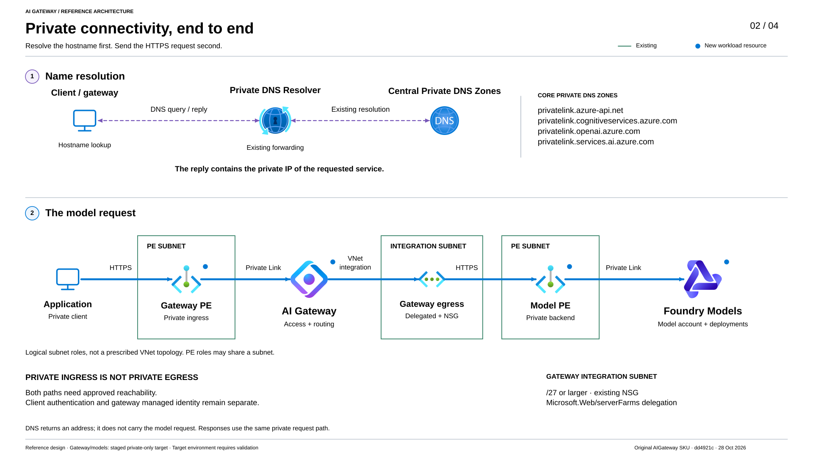
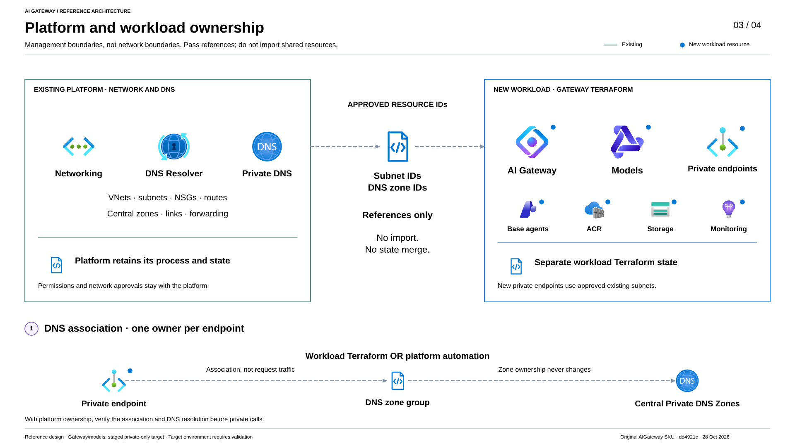

# Deployment guide

[Overview and diagrams](README.md)

## Start here

This is the step-by-step deployment guide. Start here rather than executing the
examples in every document. The other guides provide details for a selected
step; they are not additional deployments to run afterward.

**Who:** the person operating the workload's approved deployment process, with
the network/DNS owner available for the handoffs below.
**Where:** PowerShell **7**, in the approved checkout's `samples\terraform`
directory, unless a step explicitly says Azure Portal or an editor.

### First decide what already exists

| Starting situation | Network choice | Workload state and next action |
| --- | --- | --- |
| No gateway-specific network/DNS and no gateway deployment | `create` | Ask the platform owner to identify the approved state/backend for this **new workload**. The sample creates a network foundation, not a corporate landing zone. |
| Central network/DNS already exists, but this gateway has never been deployed | `existing` | Use approved platform subnet/zone IDs and the approved state/backend for the **new gateway workload**. Do not copy the network team's state into it. |
| This gateway has already been deployed with Terraform | Keep its current mode | Use its current source revision, complete inputs and authoritative state/backend. Do not start a second deployment or change ownership mode as part of this guide. |

An **existing network** is not the same as an **existing gateway deployment**.
If you do not know which row applies, stop and ask the platform/deployment owner.
The sample creates its own workload resource group; it does not automatically
adopt an existing group, private endpoint, Foundry account or model deployment.

Also decide the final access posture: **Private-only** or intentionally
**Public**. Public is the configuration default, not the recommended fallback
when a private step fails. A new private deployment uses the explicitly
approved temporary-public stages described below. If even temporary public
access is prohibited, **stop before deployment**: this guide does not establish
a private-from-first-create procedure. An already-private deployment never
repeats those stages.

### Existing-network integration at a glance

For a **new gateway workload using centrally managed network and DNS**, prepare
the following inputs and owner confirmations. This is a map to the detailed
steps, not a second runbook or permission to skip their checks.

| Prepare | Who supplies it | File or next step |
| --- | --- | --- |
| Approved source, workload subscription/tenant, naming, regions, model choices and workload state/backend | Workload owner, with the model/platform owners | Use the [approved checkout](#2-open-the-approved-source-revision). Keep base inputs in `terraform.tfvars` or the already-approved input file; follow [Inputs and state](#inputs-and-state). |
| Integration subnet, gateway/model endpoint subnets and the four core private DNS zones | Network/DNS team, through its existing provisioning process | Fill **`network-existing.environment.tfvars.json`**, copied from the shared [existing-network template](profiles/network-existing.tfvars.json), using the [field-by-field ID guide](#find-resource-ids-and-fill-in-the-network-input-file). |
| One owner for endpoint DNS associations, plus permissions, routing, access-policy and test-client approval | Platform and workload owners together | Complete the [ownership and approval table](#platform-handoff-before-a-plan), then follow the [runbook order](#runbook-order), including the approved access path. |

The filenames below are examples. Retain existing approved filenames and use
their actual paths consistently; no file rename or state migration is required.

Keep both input files in the organization's protected configuration, not in Git
or unapproved sharing channels. Do not edit the shared profiles or copy the
network team's state. If required subnets or zones are missing, the platform
team provides them through its normal process; do not select `create` as a
workaround. Optional services need their additional inputs too.

The existing-network file selects **ownership**, not Private-only access.
Select the final access posture separately; a new private deployment still
needs the approved staged procedure. For an **already deployed gateway**, retain
its current source, complete inputs and authoritative state instead of creating
these files again. An existing Terragrunt pipeline can use the
[adapter](#optional-terragrunt-adapter) **instead of** the copied network file.

### How to read a step

| Label or format | What you do |
| --- | --- |
| `powershell` block | Run in PowerShell 7, from the stated directory. Run one step at a time; stop on an error. |
| `hcl` or `json` block | Edit the named configuration file in a text editor. Do **not** paste it into PowerShell. |
| `<...>` or a zero UUID | A placeholder you must replace with an approved value, not a usable example value. |
| **Expected** | Check this visible result before proceeding; command completion alone is not always enough. |
| **Stop** | Do not run the next step, change policy, open public access, or recreate resources to get past the problem. |

Copy only the selected branch. A line beginning with `#` in HCL is a comment;
to enable an optional example, uncomment the entire selected block, fill its
values and save the file. JSON does not accept comments or trailing commas.
Use **Ctrl+S** after editing; a file named `terraform.tfvars.txt` is not
`terraform.tfvars`.

<details>
<summary>Technical background and dated preview notes (reference, not execution steps)</summary>

> [!NOTE]
> **Legacy SKU and migration deadline:** This sample uses
> `Microsoft.ApiManagement/service` with SKU `AIGateway`. Microsoft requires
> migration **before January 15, 2027**. This SKU is retained here for the
> private-endpoint scenario: as of October 25, 2026, the newer
> `Microsoft.ApiManagement/aigateways` resource does **not** support private
> endpoints. This is a time-limited preview reference, not a long-term deployment
> target. Plan migration without assuming private-endpoint feature parity;
> this sample does not perform that migration. See Microsoft's
> [migration deadline and limitations](https://learn.microsoft.com/azure/api-management/ai-gateway-resource).

## Terraform implementation

> [!IMPORTANT]
> **Terraform Registry disclaimer (checked October 25, 2026):** No dedicated
> Microsoft-published Registry module was identified for this standalone
> `AIGateway` preview. The [general API Management AVM](https://registry.terraform.io/modules/Azure/avm-res-apimanagement-service/azurerm)
> and community gateway modules are not the same as a dedicated module for this
> preview. This directory is a repository-specific root configuration, not an official
> Registry module to install.

A **module** packages reusable Terraform configuration; a **provider** implements
communication with Azure. This configuration uses Microsoft's
[AzAPI provider](https://learn.microsoft.com/azure/developer/terraform/overview-azapi-provider),
declared as `Azure/azapi` in [versions.tf](versions.tf), rather than a custom
provider or a gateway-specific module.

[ai-gateway.tf](ai-gateway.tf) declares `azapi_resource` with
`Microsoft.ApiManagement/service@2025-09-01-preview` and SKU `AIGateway`.
It also explicitly defines the gateway's child resources and their API versions.
AzAPI sends these definitions to Azure Resource Manager (ARM) and Terraform
manages their state and dependencies. The documented
[AzureRM API Management SKU list](https://registry.terraform.io/providers/hashicorp/azurerm/5.11.0/docs/resources/api_management)
does not include `AIGateway`; that is distinct from saying Terraform cannot deploy it.

Some preview child resources are not in AzAPI's bundled schema, so their local
`schema_validation_enabled` check is selectively disabled in the source.
This does **not** bypass Azure API validation, RBAC or Azure Policy. API contracts
remain explicit sample-maintenance responsibilities; `terraform validate` and
mock tests alone cannot prove that Azure will accept a deployment.

</details>

## Runbook order

| Step | Action | Continue only when |
| --- | --- | --- |
| 1 | [Prepare tools and the approved checkout](#prerequisites). | Versions and the working directory are correct. |
| 2 | [Prepare or retain the workload input file and state](#inputs-and-state). | The state owner is known, values are saved and the Azure context matches. |
| 3 | [Select create or existing networking](#network-foundation-create-or-existing). | One ownership file is selected; existing-mode IDs and the DNS owner are confirmed. |
| 4 | Complete the [platform handoff](#platform-handoff-before-a-plan). Select [test client](docs/private-connectivity.md#step-1-choose-your-test-client) and any [agent extension](#optional-private-hosted-agent) **before** the full plan. | Permissions, routes, policy, quota and optional inputs are approved. Do not run runtime tests yet. |
| 5 | Read [how to review a plan](#review-every-plan-before-apply), then prepare [monitoring](#monitoring-setup). | The destination is ready; the approved network posture was preserved. |
| 6 | Follow **one** path: [Private-only](#private-only) or [Public](#public). | The selected path's deployment and runtime gates pass. |
| 7 | If selected, deploy the [agent application](#optional-private-hosted-agent) separately. | Its own runtime identity, image pull and invocation have been checked. Otherwise skip this step. |
| 8 | Complete [acceptance and maintenance](#acceptance-and-maintenance). | Evidence, final drift result, remaining limits and cleanup ownership are recorded. |

The [Terragrunt adapter](#optional-terragrunt-adapter) is an alternative way to
connect the same inputs to an existing pipeline, not a second deployment to
run beside direct Terraform.

## Prerequisites

### 1. Open the correct terminal and check tools

Open **PowerShell 7** from the Windows Start menu, or select that profile in
Windows Terminal. The older **Windows PowerShell** is not PowerShell 7. Run:

```powershell
$ErrorActionPreference = 'Stop'
$PSVersionTable.PSVersion
git --version
terraform version
az version
```

**Expected:** PowerShell major version `7`, an installed Git and Azure CLI,
and Terraform `1.11` or newer but below `2.0`. Keep the checked-in provider
lockfile; do not run `terraform init -upgrade` as a setup shortcut.
For the optional offline CI suite also check `python --version`; the documented
CI baseline is Python 3.12+ and Terraform 1.11.4.

**Stop:** if a command is not recognized or a version is incompatible, use the
organization's approved software installation process. Official instructions:
[PowerShell](https://learn.microsoft.com/powershell/scripting/install/installing-powershell-on-windows),
[Git](https://git-scm.com/downloads/win),
[Terraform](https://developer.hashicorp.com/terraform/install),
[Azure CLI](https://learn.microsoft.com/cli/azure/install-azure-cli-windows).
Reopen PowerShell after installation and repeat the version checks. Do not
change machine-wide execution policy or install unrelated tools to bypass errors.

### 2. Open the approved source revision

Ask the workload owner for the repository URL, approved commit/tag and working
directory. Do not assume the newest remote branch is the release they approved.
For a **new checkout only**, create/select a work folder in File Explorer,
then replace the URL and revision below:

```powershell
Set-Location 'C:\work'
if (Test-Path -LiteralPath '.\ai-gateway_test') {
    throw 'Checkout already exists. Use the approved existing directory; do not overwrite it.'
}
git clone '<approved-repository-url>' ai-gateway_test
if ($LASTEXITCODE -ne 0) { throw 'Clone failed.' }
Set-Location .\ai-gateway_test
git switch --detach '<approved-commit-or-tag>'
if ($LASTEXITCODE -ne 0) { throw 'Cannot select the approved source revision.' }
```

For an **existing gateway**, open its approved deployment directory instead;
do not switch its revision or copy state using the new-checkout example.
From the repository root, enter the Terraform directory:

```powershell
Set-Location .\samples\terraform
Get-Location
Test-Path .\versions.tf
Test-Path .\profiles\network-existing.tfvars.json
git rev-parse HEAD
```

**Expected:** the path ends in `samples\terraform`, both checks return `True`,
and the SHA matches the approved revision. The network profile check also
detects an older checkout without the reuse implementation. The automated
acceptance runner needs a Git checkout and a clean source commit, not a ZIP
download. Environment-specific deployment input files remain ignored.

### 3. Confirm the platform prerequisites

Check model versions, capacity and optional hosted-agent availability in the
approved regions, inherited Azure Policy, required tags and permissions to
manage resources and scoped role assignments. Use the
[handoff table](#platform-handoff-before-a-plan); these approvals come from the
organization, not from installing Terraform.

This sample targets `Microsoft.ApiManagement/service` with SKU `AIGateway`.
Check availability for that exact resource contract, subscription and region;
the newer `Microsoft.ApiManagement/aigateways` resource is not a drop-in replacement.
Review Microsoft's [resource compatibility and lifecycle guidance](https://learn.microsoft.com/azure/api-management/ai-gateway-resource)
before deployment. This sample does not migrate resource types.

Have the platform owner confirm registration of the providers used by the selected
configuration: `Microsoft.ApiManagement`,
`Microsoft.Web`, `Microsoft.CognitiveServices`, `Microsoft.Storage`,
`Microsoft.ContainerRegistry`, `Microsoft.OperationalInsights`, `Microsoft.Insights`
and `Microsoft.Monitor`; also `Microsoft.Network` for networking, `Microsoft.Compute`
for the optional test VM, and `Microsoft.App` for private hosted agents.
The login step below includes a read-only registration check. Missing registration
belongs to the platform administrator's approved process, not an automatic fix
in this sample.

Public/private routing is independent of [Access](#access): callers can use an
API key or an Entra token with an invocation role. The gateway uses its own managed
identity for backend model calls. Adding Entra does not remove existing keys or
supply a missing private network route.

## Inputs and state

### 1. Confirm which state belongs to this workload

**Who:** the platform/pipeline owner, before the operator runs `terraform init`.
A Terraform **state** records which Azure resources this workload manages.
A **backend** is where that state is stored and coordinated.

- **New gateway:** obtain the approved workload backend configuration and
  initialization procedure. This root does not set up a shared remote backend
  for you. Plain `terraform init` without backend configuration uses local
  state; use that only for an explicitly approved local PoC.
- **Already deployed gateway:** retain its authoritative backend, working
  directory and complete current inputs. A missing local state file is not
  evidence of a new deployment; the state may be remote.
- **Existing platform network:** consume its IDs or dependency outputs. Its
  state remains with the platform owner; it is not the gateway's state.

**Stop:** if the state/backend owner or initialization procedure is unknown.
Do not initialize a second state, import the same resources elsewhere, copy a
colleague's state, or accept a backend migration/reconfiguration prompt as a
routine setup step.

<a id="2-create-or-select-your-base-input-file"></a>

### 2. Create or select a base input file

The tracked [.gitignore](.gitignore) excludes environment-specific `*.tfvars`,
`*.tfvars.json`, state and plans in this directory. The shared profiles and
`terraform.tfvars.example` are intentionally tracked. Ignoring a file does not
encrypt it or protect a file already tracked by Git.

For a **new workload with no existing input file**, run once:

```powershell
if (Test-Path -LiteralPath .\terraform.tfvars) {
    throw 'An input file already exists. Review it with its owner; do not overwrite it.'
}
Copy-Item -LiteralPath .\terraform.tfvars.example -Destination .\terraform.tfvars
```

In VS Code, choose **File > Open Folder**, open `samples\terraform`, then select
the new **terraform.tfvars**, not `terraform.tfvars.example`. Fill the table
below and save. Leave unneeded optional settings commented out.

For an **existing workload**, open its approved file instead; do not execute
the copy block. Point the session variable at that file:

```powershell
$workloadVarFile = (Resolve-Path -LiteralPath '.\terraform.tfvars').Path
# If the approved file is elsewhere, replace the path above with that actual path.
```

**Expected:** the path resolves to the saved file. For an input file **inside
this checkout**, check its ignore rule:

```powershell
git check-ignore -v -- $workloadVarFile
```

The output should identify the applicable ignore rule. If it does not, stop
before committing or sharing it. Never force-add inputs,
state, plan files or evidence. Review staged changes before any later commit.

### 3. Fill in the required values

| Value | Where it comes from and what to enter |
| --- | --- |
| `subscription_id` | Azure Portal **Subscriptions > approved workload subscription > Overview > Subscription ID**. Copy the UUID, not its display name or an ARM resource ID. |
| `environment_name` | Agree a short workload label with the platform owner: 1-32 lowercase letters, digits or hyphens, starting with a letter. For an existing workload keep its exact value. This is not an existing resource-group ID. |
| `publisher_email` | The approved operational contact address for this gateway, supplied by the workload owner. Replace `platform@example.com`. |
| `location` | The approved Azure region code for models, agent infrastructure and supporting services, not a display name. Example syntax: `swedencentral`; the example is not a region recommendation. The platform/model owner confirms availability and policy. |
| `gateway_location` | The approved gateway region code. In existing mode its integration subnet's VNet must be in this region. Create mode with the private-agent extension requires `location` to match this value. |
| `model_deployments` map keys | Agree client-facing aliases such as `gpt-mini`. Keep stable aliases for existing clients; they are not the underlying model name. |
| `model_name`, `model_version` | Have the model owner select the supported model/version in Microsoft Foundry's model catalogue/deployment configuration and copy the exact identifiers. The template's two models are examples, not quota reservations. |
| `sku_name` inside each model | Confirm the approved **model deployment type**, for example Global Standard versus an appropriate regional/data-zone offering. If omitted it defaults to `GlobalStandard`. This is not the gateway SKU. A resource's EU region alone does not establish EU-only model processing. See [deployment types](https://learn.microsoft.com/azure/ai-foundry/openai/how-to/deployment-types). |
| `capacity` | The model owner's approved allocation for that model, deployment type and region. Confirm available quota before planning. Capacity units are model/type-specific; do not assume one universal tokens-per-minute conversion. |
| `token_limit` | The agreed gateway token limit for callers. It is not the purchased model capacity and does not increase Azure quota. |

Keep all other already-approved inputs, including optional settings and
runtime identity files. There is no generic `resource_group_name` input:
the sample derives a **new workload group** from its naming inputs. After
deployment read its actual name with `terraform output -raw resource_group_name`.
Adopting an existing group is a separate integration change.

The **tenant ID** is needed for login/acceptance, not as another base tfvars
variable: in Azure Portal open **Microsoft Entra ID > Overview > Tenant ID**.
Ask the tenant administrator if it is not visible.

For optional identity fields, use an **object/principal ID**, not a client ID:

| Optional identity | Portal location or source |
| --- | --- |
| User or group in `gateway_access_principals` | **Microsoft Entra ID > Users / Groups > selected object > Overview > Object ID**. |
| Application service principal | **Microsoft Entra ID > Enterprise applications > selected application > Properties > Object ID**, not the app registration's Application (client) ID. |
| System-assigned managed identity | The actual Azure resource's **Identity > System assigned > Object (principal) ID**. |
| User-assigned managed identity | **Managed Identities > approved identity > Overview > Principal ID**, not Client ID. |
| Private hosted-agent runtime identity | Discover from the **deployed agent runtime/version** using the agent deployment process, not the project identity. Leave its optional input unset until that identity exists. |

Do not add Entra callers or agent runtime bindings merely to complete this
table. If the optional feature is not selected, its input is not required.

### 4. Sign in and verify the target

For this interactive setup, replace both placeholders and run:

```powershell
$ErrorActionPreference = 'Stop'
$tenantId = '<approved-tenant-id>'
$subscriptionId = '<approved-workload-subscription-id>'
az login --tenant $tenantId
if ($LASTEXITCODE -ne 0) { throw 'Login failed.' }
az account set --subscription $subscriptionId
if ($LASTEXITCODE -ne 0) { throw 'Cannot select the approved subscription.' }
$accountJson = az account show --output json --only-show-errors
if ($LASTEXITCODE -ne 0) { throw 'Cannot read the Azure context.' }
$account = $accountJson | ConvertFrom-Json
if ($account.id -ine $subscriptionId -or $account.tenantId -ine $tenantId) {
    throw 'Wrong tenant or subscription. Stop and contact the deployment owner.'
}
$account | Select-Object name, id, tenantId
```

**Expected:** the displayed name/IDs match the approved workload subscription
and tenant, and `subscription_id` in the saved input file matches too. If PIM
is used, activate only the approved role/scope for the agreed duration through
the organization's process; a successful login does not activate permissions.
For pipelines, use their existing approved identity flow instead of interactive
`az login`. Do not copy personal tokens or substitute a lab/admin account.

To look up a region's code after login, replace the display-name placeholder:

```powershell
az account list-locations --subscription $subscriptionId `
    --query "[?displayName=='<approved-region-display-name>'].{Code:name,Name:displayName}" --output table
if ($LASTEXITCODE -ne 0) { throw 'Region lookup failed.' }
```

This maps names only; it does **not** prove model/gateway availability or quota.
Check the required provider registrations with the platform owner. For example:

```powershell
az provider show --namespace Microsoft.Network --subscription $subscriptionId `
    --query registrationState --output tsv
if ($LASTEXITCODE -ne 0) { throw 'Cannot verify provider registration.' }
```

**Expected:** `Registered`; repeat for the providers required by the selected
features. A different result or access denial goes to the platform administrator,
not an automatic registration or permission expansion.

Have the owner review any pre-existing `ARM_*`, `AZURE_*`, `TF_VAR_*` or
`TF_CLI_ARGS*` environment settings; they can alter credentials or inputs.
Do not display secret values or silently remove pipeline authentication.

### 5. Initialize only the approved workload backend

Run the platform's approved initialization command in the confirmed directory.
The following plain command is appropriate only if that is the approved
procedure (including an explicitly approved local-state PoC):

```powershell
terraform init
if ($LASTEXITCODE -ne 0) { throw 'Initialization failed; do not continue.' }
terraform fmt -check -recursive
if ($LASTEXITCODE -ne 0) { throw 'Formatting needs review; do not rewrite shared files blindly.' }
terraform validate
if ($LASTEXITCODE -ne 0) { throw 'Configuration validation failed.' }
```

**Expected:** initialization uses the agreed backend and validation succeeds.
These checks do not deploy resources or prove Azure permissions, DNS or quota.
Inputs supplied with `-var-file` are evaluated during planning, not by `validate`.

Every later plan must include **all** approved input files. The examples show
the base file explicitly; put additional input files before the
selected ownership file and the final private-access profile. Do not copy an
old saved plan into a new session.

**Next:** select the network foundation below.

## Network foundation: create or existing

Choose **one** row and set its variable in the same PowerShell session used below.
The ownership profile does not select public access or enable private networking.
`create` is the compatibility default; `existing` requires a private-access profile.

| Starting point | Set the ownership file |
| --- | --- |
| No gateway network/DNS foundation | `$networkOwnershipFile = 'profiles\network-create.tfvars.json'` |
| Approved, centrally managed subnets and DNS zones | `$networkOwnershipFile = 'network-existing.environment.tfvars.json'` |

For **create**, [network-create.tfvars.json](profiles/network-create.tfvars.json)
keeps the existing sample names, Terraform addresses and address defaults. With
private networking enabled, Terraform creates the gateway VNet/subnets, NSGs,
private DNS zones and links. It does **not** create a corporate hub, firewall,
resolver or landing zone.

For **existing**, first make a new, untracked copy of
[network-existing.tfvars.json](profiles/network-existing.tfvars.json) named
`network-existing.environment.tfvars.json`. Replace **every** zero subscription UUID
and example resource name with approved IDs; never overwrite an existing approved
input file. The minimal example supplies gateway integration, separate per-service
gateway/model endpoint subnets and the four core DNS zones. Optional storage
endpoints, private agents and the test VM remain disabled by default; enabling
one also requires its additional network inputs. See
[required inputs and permissions](docs/private-connectivity.md#existing-network-prerequisites).

Both choices still create **new workload-owned private endpoints**. Existing mode
reads the actual subnet/VNet location, IPv4 CIDRs, delegations and gateway NSG attachment through AzAPI; it
does not edit central networks, subnet policies, NSGs, UDRs, firewall, resolver,
DNS zones or links. Different services can use different approved endpoint
subnets/VNets, resource groups and locations, but all endpoint subnets must be in
the workload `subscription_id`: the new endpoints retain workload resource-group
ownership and must share their VNet's subscription/region. Central DNS zones may
be in another subscription. Cross-subscription endpoint placement/ownership is
not implemented. It does not import existing private endpoints, resource groups,
Foundry accounts or other application resources.

Network and DNS are separate logical concerns, but only the two paired ownership
modes are supported here: create both foundations, or reuse both. Missing reuse
inputs fail; there is no silent creation fallback or mixed-ownership mode.

### Existing-network connectivity reference

This view shows **`existing` networking** with the gateway/model
**`private-only` target after approved staged setup**. Private endpoint subnet
roles may share an approved subnet; the delegated gateway integration subnet
remains separate. The drawing does not prescribe a VNet count or hub/spoke design.



[Open full-size SVG](docs/images/02-network-and-dns.svg) |
[4K PNG](docs/images/02-network-and-dns.png) |
[Editable Excalidraw source](docs/images/02-network-and-dns.excalidraw)

Blue arrows show HTTPS model traffic; purple dashed arrows show DNS queries and
replies through the existing resolver. Central zones and forwarding remain
platform-managed. Workload private endpoints still need a completed DNS
association and working resolution before private calls.

<a id="find-resource-ids-and-fill-in-your-customer-file"></a>
<a id="find-resource-ids-and-fill-in-your-network-input-file"></a>

### Find resource IDs and fill in the network input file

The network/DNS team can complete these inputs in the approved configuration.
Do not share passwords, keys or Terraform state through unapproved channels.
A resource ID is the **full Azure resource address beginning with
`/subscriptions/...`**, not a resource name, IP address or just a subscription UUID.
Keep these infrastructure details in the approved internal configuration.

#### 1. Choose approved resources

Ask the network/DNS owner which subnets and central zones this workload should
use. Do not select an arbitrary existing subnet: gateway integration needs a
dedicated, correctly delegated subnet with an attached network security group
(NSG), separate from private endpoint subnets.
See the [subnet and permission prerequisites](docs/private-connectivity.md#existing-network-prerequisites).
If a suitable subnet does not exist yet, create it through the usual platform
provisioning process, then pass its ID here; do not switch to `create` merely
to fill a missing input.

Before proceeding, have the owner complete
[the six small NSG checks](docs/private-connectivity.md#confirm-the-gateway-subnets-network-security-group).
An NSG merely existing elsewhere is not sufficient. If the subnet shows
**Network security group: None**, stop until the platform process associates
the approved NSG and checks outbound rules. The workload keeps the same subnet
ID; no separate NSG ID or new workload-owned NSG is needed.

#### 2. Find the IDs in the Azure Portal

Sign in to the correct directory and check the subscription filters. Activate
the approved PIM role if required. If a resource is not visible, ask its owner
for the ID and the necessary scoped permissions; do not create a duplicate.

| What you need | Where to find it |
| --- | --- |
| Workload subscription ID | **Subscriptions > approved workload subscription > Overview**: copy **Subscription ID**. This is the UUID for the base input `subscription_id`. |
| Subnet resource ID | **Virtual networks > approved VNet > Overview > JSON View**: find the intended subnet by its `name` inside `properties.subnets`, then copy that subnet's entire `id`. Do **not** copy the VNet's top-level `id`. Repeat for each required subnet. |
| Private DNS zone resource ID | **Private DNS zones > approved zone > Overview > JSON View**: copy the top-level `id`. Check the zone name, resource group and subscription with the DNS owner. Use the private DNS **zone** ID, not a public DNS zone, resolver resource ID or resolver IP address. |

The endpoint subnets, and the optional test-client subnet if enabled, must
belong to the workload `subscription_id`. Central DNS zones may belong to a
different subscription. Copy each complete ID from its actual resource rather
than replacing every subscription UUID with the same value.

<a id="3-fill-in-your-own-configuration-file"></a>

#### 3. Fill in the configuration file

In `samples\terraform`, copy
[profiles\network-existing.tfvars.json](profiles/network-existing.tfvars.json)
to **`network-existing.environment.tfvars.json`**. Keep the shared example unchanged;
if an approved input file already exists, edit that file without overwriting
it with the template. Follow [Inputs and state](#inputs-and-state) to keep input
files out of Git; never force-add them.

For a **new input file only**:

```powershell
if (Test-Path -LiteralPath .\network-existing.environment.tfvars.json) {
    throw 'Environment-specific network inputs already exist. Review that file instead of overwriting it.'
}
Copy-Item -LiteralPath .\profiles\network-existing.tfvars.json `
    -Destination .\network-existing.environment.tfvars.json
```

Open the copied file in VS Code. Replace each complete resource-ID string
inside its existing quotes, using the table below, then press **Ctrl+S**.

Set the workload `subscription_id` in the base inputs, normally
`terraform.tfvars`. In the copied JSON file, keep
`"private_network_mode": "existing"` and replace the example values under
**`existing_private_network`** using this mapping:

| Field under `existing_private_network` | Approved resource ID to enter |
| --- | --- |
| `gateway_subnet_id` | The gateway's dedicated outbound-integration subnet, with its approved NSG already attached. |
| `endpoint_subnet_ids.gateway` | The subnet for the gateway's inbound private endpoint. |
| `endpoint_subnet_ids.models` | The subnet for the model account's private endpoint. |
| `private_dns_zone_ids.gateway` | The central zone named `privatelink.azure-api.net`. |
| `private_dns_zone_ids.cognitiveservices` | The central zone named `privatelink.cognitiveservices.azure.com`. |
| `private_dns_zone_ids.openai` | The central zone named `privatelink.openai.azure.com`. |
| `private_dns_zone_ids.services` | The central zone named `privatelink.services.ai.azure.com`. |

The dotted field names in the table describe the existing nested JSON structure;
replace the string values in that structure rather than adding literal dotted
keys. Keep quotes, commas and braces intact and remove all example IDs.
The gateway and model endpoints may share an approved endpoint subnet, but
neither may use the delegated integration subnet.

The starter file covers gateway/models only. If you enable storage endpoints,
private hosted agents or the test VM, also supply the
[additional required inputs](docs/private-connectivity.md#existing-network-prerequisites).
Confirm [who manages the DNS zone groups](#choose-the-dns-zone-group-owner):
keep `workload` only if this Terraform deployment should create those associations;
choose `platform` when central policy or automation owns them.

Check the saved JSON locally:

```powershell
$networkInput = Get-Content -LiteralPath .\network-existing.environment.tfvars.json -Raw | ConvertFrom-Json
if ($networkInput.private_network_mode -cne 'existing') { throw 'Expected existing network mode.' }
if (Select-String -LiteralPath .\network-existing.environment.tfvars.json `
        -Pattern '00000000-0000-0000-0000-000000000000|<[^>]+>' -Quiet) {
    throw 'Replace the remaining network placeholders before continuing.'
}
git check-ignore -v -- network-existing.environment.tfvars.json
```

**Expected:** no JSON/placeholder error, and an ignore-rule result. This checks
syntax and obvious placeholders only; Terraform's later plan reads the actual
subnets and validates their regions, prefixes, delegations and gateway NSG
attachment. It does not prove effective firewall/NSG rules or runtime connectivity.

#### 4. Connect the file to the deployment process

Set `$networkOwnershipFile = 'network-existing.environment.tfvars.json'` in the
PowerShell session for the runbook. This file is **not automatically loaded**:
include it explicitly alongside the complete base inputs and private-access
profile as shown in [Compose the inputs](#compose-the-inputs). It selects network
ownership, not private access, and does not by itself deploy anything.

Correct IDs alone do not establish routes, DNS resolution or permissions.
Have the platform team confirm those prerequisites before the reviewed plan and
private-path acceptance. If this workload is already deployed, retain its state
and ownership until the separate migration review described below is complete.

**Already using Terraform/Terragrunt?** Instead of copying IDs manually, expose
the approved subnet and zone IDs as outputs of the existing platform modules
and map them into this workload. The [Terragrunt adapter](#optional-terragrunt-adapter)
shows the expected output names and dependency wiring; adapt them to the platform
modules and keep the authoritative backend/pipeline. This does not require
sharing or copying the platform's state into the gateway deployment.

### Compose the inputs

The order is **base inputs → additional input files → network ownership →
private-access profile → explicitly approved endpoint compatibility override**.
Keep the complete selection on every full, targeted and drift plan. Resolve the
two selected files, without changing that selection:

```powershell
if (-not $workloadVarFile -or -not $networkOwnershipFile) {
    throw 'Select the approved base and network ownership files first.'
}
$workloadVarFile = (Resolve-Path -LiteralPath $workloadVarFile).Path
$networkOwnershipFile = (Resolve-Path -LiteralPath $networkOwnershipFile).Path
```

Choose **one** additional-file line. These are other approved workload inputs,
not the ownership file or access profile:

| Deployment inputs | Set in PowerShell |
| --- | --- |
| No additional input files | `$additionalVarFiles = @()` |
| Additional files, for example a deployed agent's runtime identity | `$additionalVarFiles = @('C:\secure\private-agent-runtime.tfvars.json')` using the actual approved path; add other paths inside the same array if required. |

Turn that selection into the arguments used below:

```powershell
$additionalVarFiles = @($additionalVarFiles | ForEach-Object {
    (Resolve-Path -LiteralPath $_).Path
})
$additionalInputArgs = @($additionalVarFiles | ForEach-Object { "-var-file=$_" })
```

Choose **one** endpoint-compatibility line too:

| Existing endpoint choice | Set in PowerShell |
| --- | --- |
| New endpoint, or an already approved manual endpoint | `$endpointCompatibilityArgs = @()` |
| Preserve an existing healthy automatic endpoint, specifically approved by the workload owner | `$endpointCompatibilityArgs = @('-var=gateway_private_endpoint_manual_approval=false')` |

The second case prevents the shared profile from silently selecting a replacement
manual endpoint. Do not invent other overrides or use this mechanism to reopen
public access. The automatic acceptance runner cannot append these post-profile
overrides; use [manual acceptance](docs/acceptance.md) when one is required.

**Expected:** both files exist. Reading/selecting them does not deploy anything.
The actual plan commands appear in the monitoring and selected deployment steps.
The private-only profile is the desired final posture, **not** a verified
private-from-first-create shortcut. The explicitly approved intermediate stages
below change only the private-access profile/temporary override, not the chosen ownership inputs.
Never use an intermediate profile on an already-disabled gateway or model account.
Do not add a later override that reopens public access.

Do not switch an already-deployed `create` network to `existing` as a normal
update: Terraform can propose deleting the sample-managed foundation. Retain the
authoritative backend, state, resource addresses and ownership until a separately
reviewed state/migration plan is approved. The created VNet has a
`prevent_destroy` guard that blocks accidental ownership mode changes; do not
bypass it. Do not copy state or import the same central resources into
another owner.

### Choose the DNS zone-group owner

- **`private_dns_zone_group_management = "workload"` (default):** Terraform writes
  the new endpoints' zone-group associations to the selected zones. In existing
  mode this needs explicit, scoped permissions on those zones and the endpoints;
  owning the endpoint alone does not grant central DNS access.
- **`"platform"` (existing mode only):** Terraform leaves zone groups to Azure
  Policy or the central deployment process. Still supply all required zone IDs.
  The platform must complete endpoint associations/records and resolver readiness
  before private calls, agent use or access closure. Terraform intentionally
  does not wait for policy or manage central records/links. Do not let two
  processes own the same group.

Changing an existing deployment between workload/platform DNS ownership is a
separately reviewed state handoff, not a routine flag flip. Review any zone-group
removal/recreation and DNS continuity with both owners; no automatic import or
ownership transfer is performed.

Terraform success does not prove DNS propagation, firewall routing or runtime
connectivity. A central resolver is valid without a direct DNS-zone link to every
spoke; the network/DNS team retains the approved links/forwarding design.

## Platform handoff before a plan

**Who:** the workload operator gathers these confirmations from the named
owners. A copied ID is not a permission grant or a connectivity test.

The ownership boundaries below describe **`existing` mode**. For `create`,
the sample instead owns its new network/DNS foundation; approve the new address
range and check overlap as described in [network foundation](#network-foundation-create-or-existing).



[Open full-size SVG](docs/images/03-resource-ownership.svg) |
[4K PNG](docs/images/03-resource-ownership.png) |
[Editable Excalidraw source](docs/images/03-resource-ownership.excalidraw)

These are management boundaries, not network boundaries. Passing resource IDs
does not import platform resources or merge Terraform states. Each endpoint has
one DNS zone-group owner; central zones remain platform-owned in either case.
The same infrastructure team may operate both platform and workload roles.

| Area | Owner and Terraform boundary | Confirmation needed before planning |
| --- | --- | --- |
| Gateway workload and state | Workload team owns the new application resources and private endpoints in its approved workload state. Existing platform state stays separate. | Exact source revision, subscription/tenant, backend, naming, current gateway deployment status and final access posture. Existing networking does not import an existing gateway or application resource. |
| VNets, subnets and network security groups | Network team retains the resources and their state; workload Terraform only reads approved subnet/VNet details. | Complete integration/endpoint subnet IDs, delegations, attached gateway NSG, available addresses and service-region placement. |
| Routes, firewall and DNS resolver | Network/platform team retains routes, firewall, resolver and forwarding; this sample does not create or change them. | Client-to-gateway and gateway-to-model routes, DNS forwarding and control-plane/identity egress. Optional VM and agent routes need separate approval. |
| Central private DNS zones and VNet links | DNS team retains zones, links and their state. The workload references zone IDs, not ownership of those resources. | Exact required zone IDs and the approved resolution design; a direct zone link to every spoke is not required when central resolution is used. |
| Private endpoint DNS zone groups | **One owner:** workload Terraform with `workload`, or central Policy/automation with `platform`. This does not transfer ownership of the zones. | Agree who finishes associations/records after endpoint creation and verifies resolver results. Use the [DNS ownership choice](#choose-the-dns-zone-group-owner); never let both processes own the same group. |
| Deployment permissions | Identity/platform administrator grants scoped access; knowing a resource ID does not grant access. | Effective deploy/read/join/endpoint/approval and role-management permissions, PIM duration and deny assignments. Workload-managed zone groups also need access to the specified central zones. |
| Models | Model owner approves model selection and allocation; the sample creates its workload model deployments. | Exact model names/versions, deployment geography, quota/capacity and a billable test allowance. |
| Policy and access sequence | Security/platform owner approves the deployment; this sample does not relax central policy. | Region/type/tag policy and the entire access sequence. Temporary public access needs explicit approval, not just approval of the final private design. |
| Testing and operation | Test/operations owner selects the client and owns evidence, cleanup and ongoing operation. The sample VM is optional. | Existing private client or approved test VM, test permissions, evidence location and cleanup/monitoring responsibility. |

Do not demand `Approved` endpoints before they have been created. Those are
**post-apply gates**, explained in the
[endpoint and DNS readiness steps](docs/private-connectivity.md#endpoint-and-dns-readiness).
For platform DNS, agree how the operator is notified when central automation
finishes; Terraform does not wait for that handoff.

**Stop:** missing IDs, permissions, quota, routing or approvals go to the
corresponding owner. Do not select a convenient but unrelated subnet, request
Owner for the test VM, create duplicate DNS zones or disable policy.

### Optional Terragrunt adapter

**Who:** the Terraform/Terragrunt platform maintainer. If the operator does not maintain
that pipeline, ask its maintainer to adapt this subsection. Do not build a
second deployment system. If you do not use Terragrunt, keep the direct
Terraform input-file workflow above.

[terragrunt-existing.hcl.example](examples/terragrunt-existing.hcl.example) consumes
separate network and DNS dependencies and uses this **same standalone Terraform
root from a local checkout**, not unpublished remote feature code.

#### 1. Identify the existing live units and workload state

The following is an **illustrative layout**. `platform-live` represents the
existing deployment-configuration repository; `live` does not mean production-only.
Retain existing folders, input-file names, include labels and backend/state
configuration. No renaming or recreation is required.

```text
C:\work\gateway-source\ai-gateway_test\samples\terraform\  approved clean source
C:\work\platform-live\
  root.hcl                    existing include/auth/backend conventions
  network\terragrunt.hcl       existing, applied network unit
  dns\terragrunt.hcl           existing, applied central-DNS unit
  ai-gateway\
    terragrunt.hcl            adapted copy of the supplied adapter
    workload.tfvars           approved non-network workload inputs
```

Confirm which existing `root.hcl` and backend/state key belong to this workload.
For a new gateway, use its approved new workload unit; for an already managed
gateway, do not introduce a second unit/state owner. The network and DNS units
remain independent. The sample does **not** create `root.hcl`, choose a backend
or migrate any state.

#### 2. Confirm available outputs before editing the adapter

Ask the platform maintainer to inspect only the relevant outputs through the
existing platform pipeline. No full state export is needed. The dependency
units must already be applied and readable by the approved runner.

| Dependency | Expected outputs |
| --- | --- |
| `network` | `gateway_subnet_id` (string), `endpoint_subnet_ids` (map containing `gateway` and `models`) |
| `dns` | `private_dns_zone_ids` (map containing `gateway`, `cognitiveservices`, `openai`, `services`) |

Each value is a **full resource-ID string**, not a resource name or a whole
subnet/zone object. If the platform uses other output names, change the adapter's
right-hand-side expressions to the real outputs. For example, only if the
existing module actually exposes that map/key:

```hcl
gateway_subnet_id = dependency.network.outputs.subnet_ids["gateway-integration"]
```

This is one field **inside** `inputs.existing_private_network`, not a new
top-level Terraform variable. The four DNS keys still map to the exact zone
names in the [ID lookup table](#find-resource-ids-and-fill-in-the-network-input-file).
Missing output or `Unsupported attribute` means stop and correct the contract
with its owner; do not fill deployment dependencies with fake `mock_outputs`.

#### 3. Place and adapt the two workload files

Copy the supplied adapter into the approved workload unit as `terragrunt.hcl`
**only if that file does not already exist**. For an existing file, the
maintainer integrates the blocks through the usual review process instead of
overwriting its settings. Create/select that unit's protected `workload.tfvars`
using the [base input catalogue](#inputs-and-state), without copying another
deployment's state.

| Adapter field | What to set for the illustrative layout |
| --- | --- |
| `include "platform"` | Retain the approved parent include and its label. `find_in_parent_folders("root.hcl")` is correct only when that is the existing platform convention. |
| `locals.sample_root` | `"C:\\work\\gateway-source\\ai-gateway_test\\samples\\terraform"` for the approved clean source checkout. Record its exact commit and keep deployment tfvars/state out of it. |
| `dependency "network".config_path` | `"${get_terragrunt_dir()}\\..\\network"` for the existing network unit. It is not a subnet ID. |
| `dependency "dns".config_path` | `"${get_terragrunt_dir()}\\..\\dns"` for the existing DNS unit. It is not a zone ID. |
| First `extra_arguments` var-file | The approved workload input file, shown here as `workload.tfvars`; retain an existing filename and any additional runtime input files before the access profile. |
| `inputs.existing_private_network` | Map the verified platform outputs, preserving the required nested field names. |
| `private_dns_zone_group_management` | `workload` only with the agreed permissions; `platform` only when central automation owns the associations. |

HCL quoted Windows paths use `\\`. Save the edited file. Check **the live
repository's** ignore rules for inputs, plans, cache and evidence: this sample's
`.gitignore` does not protect a different live repository.

Keep network-ownership fields out of `workload.tfvars` and inherited var-files:
explicit Terraform var-files can override Terragrunt `inputs`. Do **not** also
load the placeholder `network-existing.tfvars.json`. The adapter already obtains
those IDs from dependencies. Inspect inherited extra arguments/environment and
all runtime files with the pipeline owner rather than assuming this unit's
visible block is the complete configuration.

#### 4. Use the existing pipeline, for this workload unit only

The adapter selects **final private-only posture**, not a verified
private-from-first-create bootstrap. Resolve the same monitoring, temporary-access
approval and DNS readiness gates as the direct path before running a full plan.
Do not silently remove the private profile to get a new deployment through.

From the approved workload live-unit directory, the maintainer can use the
installed Terragrunt version's normal plan job. The current CLI supports
[`run --`](https://docs.terragrunt.com/reference/cli/commands/run/); the equivalent
single-unit saved-plan example is:

```powershell
Set-Location 'C:\work\platform-live\ai-gateway' # Replace with the approved live unit.
terragrunt --version
$planPath = 'C:\protected-evidence\gateway\terragrunt-private.tfplan'
terragrunt run -- plan -input=false "-out=$planPath"
if ($LASTEXITCODE -ne 0) { throw 'Terragrunt workload plan failed.' }
terragrunt run -- show $planPath
if ($LASTEXITCODE -ne 0) { throw 'Cannot inspect the Terragrunt workload plan.' }
```

Use the approved, existing restricted artifact folder; do not invent a new
backend or upgrade Terragrunt for this example. Terragrunt can initialize/read
backends and execute inherited hooks even for a plan, so this is a
**target-authorized pipeline operation**, not an offline syntax test.
Do not run `--all`/`run-all` or apply the network/DNS units to install the gateway.

Review the [same ownership/access checklist](#review-every-plan-before-apply).
Then use the normal approval and saved-plan apply job for **this
workload**, preserving its exact source, backend and artifact. The platform
maintainer owns the installed version's cache/artifact and
[extra-argument handling](https://docs.terragrunt.com/features/units/extra-arguments/);
do not guess a `.terragrunt-cache` path or start plain Terraform in the live unit.

The sample's PowerShell helpers run Terraform relative to their own source
directory; they do not automatically locate a Terragrunt unit/cache or inherit
its input arguments. The maintainer must integrate output/drift/test execution
with the **same configured module and state** and record source provenance.
Until that integration exists, use the manual acceptance steps through the
approved pipeline, adapting the output commands there. Do not run a helper
against the clean source checkout or copy state to make it work.

**Expected handoff:** mapped real outputs, one approved workload owner/backend,
a reviewed plan with no central-network changes, and a named pipeline/test
operator. Pipeline integration and live connectivity remain work
for that operator; this adapter is not a separate turnkey deployment system.

## Access

Grant identity-based access with **Microsoft Entra ID**, or manage **API keys**.
The [end-to-end private request sequence](docs/architecture.md#end-to-end-private-request-flow)
shows client authentication, DNS and the gateway's separate backend identity.
It explains runtime behavior, not deployment order.

API-key behavior remains the default. To add Entra callers, extend the existing
ignored input file; do not replace its other settings:

```hcl
gateway_access_principals = {
  application = {
    principal_id   = "<actual-managed-identity-or-service-principal-object-id>"
    principal_type = "ServicePrincipal"
  }
}
```

Use Entra **object IDs**, not application/client IDs, from the gateway
subscription's tenant. Types are `User`, `Group` or `ServicePrincipal` (default,
including managed identities); each object ID may appear once. Terraform grants
**AI Gateway Models User** (`a6b68e3d-a1f0-4c60-8678-237c050cf4ea`) at gateway scope:
all models, not MCP tools, management operations or key retrieval. For one-model
access, use a separately reviewed alias-scoped assignment instead of this map.
The executor needs role-assignment permission at the gateway scope.

This works as an **additive post-deployment change**: reuse the original state and
complete inputs, retain the final Private-only profile last, and review a fresh
saved plan before applying it. Keep map keys stable and entries on subsequent
plans; removing an entry removes its managed role. Import equivalent pre-existing
assignments at the intended address or keep them externally managed, not duplicated.

Use audience `https://azure-api.net/aigateway`; SDK clients calling as themselves
request `https://azure-api.net/aigateway/.default`. Custom apps signing in users
need delegated `https://azure-api.net/aigateway/Data.All` consent plus the user's
invocation role. This custom-app consent setup does not apply to managed identities,
client credentials or built-in Azure CLI/PowerShell clients. Send
`Authorization: Bearer <token>`, never an ARM or model-backend token. See the
[portal security and identity guide](https://ai.gateway.azure.com/docs/security-identity).

```powershell
# Run these probes only after deployment, from a client with the selected route.
.\scripts\Test-ModelAliases.ps1 -Authentication EntraId
# Existing default:
.\scripts\Test-ModelAliases.ps1 -Authentication ApiKey
```

The Entra probe uses the current Azure CLI identity, does not retrieve keys and
does not fall back to them. It calls every compatible alias and incurs inference
charges. The caller needs the selected network/DNS route and propagated RBAC.
Verify both authorized and unauthorized identities and fresh telemetry; offline
checks are not a live Entra proof.

**Live-verified:** a managed-identity caller reached both sample aliases over the
private endpoint: HTTP 403 before the Terraform-managed invocation grant, HTTP
200 afterward, with matching gateway/backend traces. Missing, invalid and
wrong-audience credentials returned 401; API-key calls remained successful.
The temporary grant was removed and the final plan had no changes. This does
not validate custom delegated-user clients or migrate the hosted agent.

**Not Entra-only:** keys are neither disabled nor deleted. The existing agent and
private VM retain their key-reader roles and API-key calls. The gateway's backend
Foundry User binding stays unchanged. An empty map also does not remove roles
managed outside this sample.

## Review every plan before apply

**Who:** the workload operator and the owner authorized to approve the change.
**Where:** the same PowerShell session, source revision, backend and input files
used to create the plan.

1. Run the plan command for the **selected step**, saving its `.tfplan` file.
   Stop if it fails; an older file with the same name is not a valid new plan.
2. Run that step's `terraform show <saved-file>.tfplan` command. Read the
   individual resource changes, not just the final action count.
3. Use the table below and obtain approval for the actual changes and cost.
4. Only then run `terraform apply <that-same-file>.tfplan`. **Applying a saved
   plan does not ask for another interactive confirmation.** Do not paste the
   plan and apply blocks together before reviewing.
5. Wait for successful completion and perform the step's Azure/DNS/runtime
   checks. If an apply fails partway through, retain its state and investigate;
   it is not safe to assume that nothing was created.

| Plan display | Meaning and review action |
| --- | --- |
| `+` create | A new resource. Check its type, subscription/group, subnet, access posture, role scope and cost. |
| `~` update in-place | An existing resource changes. Inspect the old/new values; in-place does not mean harmless. |
| `-` destroy | A deletion. Stop unless that exact deletion and any data loss were separately approved. |
| `-/+` or `+/-` replacement | Terraform recreates a resource. Stop for separate review of downtime, identity, data and address changes. |
| `<=` read | A data-source read, not ownership of the referenced resource. Existing-mode subnet/VNet reads are expected. |
| Output changes | Exported metadata changes. They are not a substitute for checking resource actions and actual connectivity. |

For **existing-network mode**, new workload private endpoints, workload
resources and approved role assignments are expected. Workload-owned DNS
**zone groups** may be new even though the DNS **zones** are reused. The plan
must not create, change or remove centrally managed VNets, subnets, NSGs, routes,
resolver, central zones or links. In `platform` DNS mode this Terraform must
not also take ownership of the endpoint zone groups.

For **create mode**, the approved sample network/DNS foundation is expected,
not a new corporate hub/firewall. For either mode, reject unapproved permission
expansion, resource replacement and public-access reopening. An existing
deployment must retain stable naming, resource addresses and ownership.
There is no universally correct resource count; optional features and
service-managed monitoring resources affect it.

With `-detailed-exitcode`, exit `0` means no changes, `1` means failure, and `2`
means changes were found. Exit `2` is not automatic permission to apply. A
saved deployment plan without that flag normally exits `0` even when it proposes
changes. Keep plan files/output protected; never publish them with the source.

## Monitoring setup

The gateway exporter needs real OpenTelemetry Protocol (OTLP) endpoints and a
linked Data Collection Rule (DCR), discovered from Application Insights.
First create that monitoring destination, then create a fresh full deployment plan.
Do not supply guessed endpoints or copy generated IDs.

**Choose the starting state first.** Copy the assignment from exactly one row
into the same PowerShell session before running the commands below. If you use
extra environment `-var-file` arguments, put them before the selected ownership
file and listed profile/overrides.

| Starting state | Set the monitoring plan arguments |
| --- | --- |
| Intentionally Public (keep `create` ownership) | `$networkArgs = @()` |
| Already Private-only | `$networkArgs = @('-var-file=profiles\private-only.tfvars.json')` |
| Gateway still public, but models already private | `$networkArgs = @('-var-file=profiles\private-connectivity.tfvars.json')` |
| New private environment or public-to-private transition, with temporary public access explicitly approved | `$networkArgs = @('-var-file=profiles\private-connectivity.tfvars.json', '-var=models_public_network_access=Enabled')` |

For new private environments where even temporary public access is prohibited,
**stop**: this guide does not provide a validated private-from-first-create procedure.

```powershell
if ($null -eq $networkArgs) { throw 'Choose the monitoring arguments for the current deployment state first.' }
if (-not $networkOwnershipFile) { throw 'Choose the network-ownership file first.' }
terraform plan -input=false "-var-file=$workloadVarFile" @additionalInputArgs `
    "-var-file=$networkOwnershipFile" @networkArgs @endpointCompatibilityArgs `
    '-target=azapi_resource.insights["gateway"]' '-out=monitoring-destination.tfplan'
if ($LASTEXITCODE -ne 0) { throw 'Monitoring destination plan failed.' }
terraform show monitoring-destination.tfplan
if ($LASTEXITCODE -ne 0) { throw 'Cannot inspect the saved monitoring plan.' }
```

Review the plan using the [checklist](#review-every-plan-before-apply).
For a new workload the monitoring destination can include its resource-group
and workspace prerequisites. For an existing destination, expect only the
approved monitoring update, not a network or gateway replacement.

**Only after approving that exact plan**, run the Azure-changing command:

```powershell
terraform apply monitoring-destination.tfplan
if ($LASTEXITCODE -ne 0) { throw 'Monitoring destination apply failed; stop.' }
```

**Next, check readiness** rather than inventing the generated monitoring IDs:

```powershell
$metadata = terraform output -json gateway_monitoring
if ($LASTEXITCODE -ne 0) { throw 'Cannot read monitoring metadata.' }
$metadata = $metadata | ConvertFrom-Json
.\scripts\Get-GatewayMonitoring.ps1 `
    -SubscriptionId $subscriptionId `
    -ApplicationInsightsId $metadata.insights_id `
    -ExpectedLogAnalyticsId $metadata.log_analytics_id -WaitSeconds 120
```

**Expected:** returned verified destination metadata, including endpoints and a
linked DCR, without a timeout/permission/provisioning error. If it is not ready,
use the [failure table](#if-something-fails-or-you-open-a-new-terminal) before
proceeding. Do not recreate the destination or paste an old DCR ID.

Never drop the private profile or ownership inputs on an existing private
environment. Review targeted plans too: they can include dependencies.
The helper is read-only and checks destination
readiness, DCR/DCE ownership and the linked Log Analytics/Azure Monitor workspaces.
After it succeeds, create a **fresh full plan** for the selected path. Terraform
then configures the exporter and the gateway's publisher role on the linked DCR.

For a bounded existing-exporter repair, target `azapi_resource.telemetry_exporter`
with the same inputs. If Azure rejects an in-place exporter-kind change, stop:
replacement needs its own reviewed `-replace=azapi_resource.telemetry_exporter`
plan and explicit deletion/recreation approval. It is not atomic and must not
replace the gateway or delete monitoring data.

## Public

Use only when public gateway/model endpoints are intentional. It is the Terraform
default, **not** a required prerequisite for Private-only.

```powershell
terraform plan -input=false "-var-file=$workloadVarFile" @additionalInputArgs `
    "-var-file=$networkOwnershipFile" @endpointCompatibilityArgs -out=deployment.tfplan
if ($LASTEXITCODE -ne 0) { throw 'Public deployment plan failed.' }
terraform show deployment.tfplan
if ($LASTEXITCODE -ne 0) { throw 'Cannot inspect the saved public plan.' }
```

**Expected:** the reviewed public configuration, complete approved workload
inputs and `create` ownership, with no removal of an existing private setup.
Review [every planned change](#review-every-plan-before-apply). Only after
approval, execute the saved plan:

```powershell
terraform apply deployment.tfplan
if ($LASTEXITCODE -ne 0) { throw 'Public deployment apply failed; stop.' }
```

**Next:** run the billable smoke test from the selected public client, then
check drift with the same inputs:

```powershell
.\scripts\Test-ModelAliases.ps1
terraform plan -input=false "-var-file=$workloadVarFile" @additionalInputArgs `
    "-var-file=$networkOwnershipFile" @endpointCompatibilityArgs -detailed-exitcode
$driftExit = $LASTEXITCODE
if ($driftExit -ne 0) { throw "Drift check exit $driftExit; review before continuing." }
```

The probe makes billable calls to every configured chat-completions alias from
the deployment client. All aliases must answer; final plan exit `0` means no changes,
`1` means an error, and `2` means changes requiring review.

## Private-only

The final [private-only profile](profiles/private-only.tfvars.json) disables
**both gateway and model public access**. Private clients reach the gateway's
private endpoint; separate gateway outbound VNet integration reaches the model
private endpoint. Private DNS, endpoint approval and working routes are all required.

For an **already private** deployment, skip temporary-public staging. Keep
`-var-file=profiles\private-only.tfvars.json` last on every full, monitoring and
drift plan, after the complete workload and selected ownership inputs.
Never apply the intermediate profile to an already-disabled gateway.

For a **new environment or one transitioning from public**, use these provisioning
stages only where temporary public access is explicitly permitted and the legacy
resource contract is available. The retained
`private-connectivity` file is an intermediate stage, **not a third deployment path**:

| Stage | Plan arguments, after workload and ownership inputs | Required gate before continuing |
| --- | --- | --- |
| Prepare private networking | `-var-file=profiles\private-connectivity.tfvars.json -var=models_public_network_access=Enabled` | Review/apply; gateway/model remain public. Approve private endpoints, complete workload/platform DNS readiness and prove private DNS/inference. |
| Close model public access | `-var-file=profiles\private-connectivity.tfvars.json` | Review/apply; model disabled. Repeat the private probe. |
| Close gateway public access | `-var-file=profiles\private-only.tfvars.json` | Review/apply; both disabled. Recheck private inference and authenticated public-network rejection. |

Do not reopen access to bypass a failure or Azure Policy. If temporary public access
is prohibited, do not use this staged procedure unchanged: validate a supported
private creation sequence first. First-create behavior is not proven by a
successful update of an existing gateway.

Wait for actual ARM provisioning completion and approved/succeeded private
connections. On an asynchronous timeout, inspect actual state before making a new
plan; an accepted update is not proof of completion. All callers, including agents
and CI, need their own private connectivity before gateway public access is closed.

The actual private execution steps are kept together in the
[private-path runbook](docs/private-connectivity.md#step-1-choose-your-test-client):

1. Select **existing private client** or **optional sample VM** in Step 1.
   The VM needs a public SSH key and extra scoped permissions; it is not required
   merely because the gateway is private.
2. For approved new/temporary-public provisioning, perform Step 2 and review its
   saved plan before applying. For an existing private deployment, use
   [its entry](docs/private-connectivity.md#existing-private-deployments) instead;
   never reopen a closed endpoint.
3. Perform Step 3's endpoint/DNS readiness checks and the commands for the
   selected client. Both client paths are explicit; do not call the VM wrapper
   when no sample VM exists.
4. Close model and gateway access through Step 4 only after the required private
   checks pass. Repeat the selected client's check after each closure.
5. Complete Step 5's final runtime and full drift checks. If using the VM,
   perform Step 6's deallocation even after a failure.

**Expected:** the selected clients can use the private route, both public-access
settings are disabled, the full drift plan has no changes and authenticated
public-network rejection is demonstrated separately. A DNS/inference check alone
is not full acceptance.

**Return here afterward:** perform the optional agent application step below,
or skip directly to [acceptance](#acceptance-and-maintenance).

## Optional private hosted agent

For a new private agent, enable the networking configuration **before account
creation**; it cannot simply be added to an existing agent account afterward:

```hcl
enable_private_networking   = true
enable_private_hosted_agent = true
# In create mode, location must equal gateway_location.
# In existing mode, the supplied agent subnet's VNet must instead match location.
```

Keep the final private-only profile last, after workload and ownership inputs.
In create mode, `location` must equal `gateway_location` because the sample uses
one VNet. In existing mode, provide `agent_subnet_id` delegated to
`Microsoft.App/environments` in the agent region, at least `/27` and wholly
within this sample's supported RFC1918 IPv4 address space. This is a sample
subset, not a universal platform restriction; see the
[agent subnet requirements](docs/private-connectivity.md#existing-network-prerequisites).
Also supply `agents` and `registry` endpoint subnet IDs and the `registry` DNS
zone ID. The extension adds an account/project,
uses a created or supplied outbound-injection subnet, creates inbound Foundry
and registry private endpoints, and adds scoped project permissions.
It reuses the gateway/model
route and monitoring. Foundry public access is disabled; ACR public access is
unchanged. DNS changes affect every client in the linked VNet.

The Foundry private endpoint is **inbound**; agent network injection is **outbound**.
The account has `prevent_destroy`; turning off the flag or changing injection
requires an approved migration. Basic agent data is Azure-managed, not a
separately provisioned private Storage/Cosmos DB/Search setup. This is not deny-all egress:
Entra, ARM and telemetry connectivity still need validation; no NAT/firewall or
fully private monitoring path is added.

Terraform does **not** deploy an image or agent application:

1. Read `terraform output -json private_hosted_agent` for the **new** project and
   endpoints; compatibility outputs `project_id`/`project_endpoint` refer to the
   original project. Verify account/capability-host provisioning and private DNS,
   including registry login and regional data endpoints.
2. Deploy the application from a private executor using the
   [hosted-agent/private ACR guide](https://learn.microsoft.com/azure/foundry/agents/how-to/deploy-hosted-agent-private-azure-container-registry).
   Do not reprovision Terraform-owned infrastructure through a second workflow.
   For a prebuilt image, explicitly configure image passthrough by digest rather
   than assuming a package argument suppresses builds. Scope any build/deploy
   permissions to the required resources.
3. Discover the actual deployed **runtime managed-identity object ID**. Verify
   runtime AcrPull on the exact registry separately from Terraform's project
   AcrPull. Record the owner of any role assigned outside Terraform.
4. Set `private_hosted_agent_runtime_principal_id` to that verified ID and review
   a new plan with complete inputs and the private-only profile last. This binds
   narrow gateway key retrieval; the agent still calls the gateway with an API key.
   Never persist that key in tfvars, state, logs or agent metadata. Verify both
   runtime roles again if a new agent version changes identity.

Remove only job-created temporary roles and deallocate the executor after use.
Keep the runtime-principal input on subsequent plans, or its binding can be removed.

Changing `enable_private_test_client` changes the private agent's key-reader role.
Terraform replaces that role assignment rather than updating its immutable role.
Upgrading an older assignment also requires a one-time replacement; review the
plan and allow for a brief interruption of the agent's key retrieval.

## Acceptance and maintenance

Require fresh results in the selected environment, not screenshots from another
deployment: each alias succeeds, missing/invalid gateway keys are rejected, expected
roles/connections and private DNS are correct, and gateway/backend telemetry
correlates to the same request. For Private-only, a **valid authenticated request
from outside the private route** must receive explicit network denial; a 401,
authentication-related 403, timeout or DNS error is not equivalent.

For a hosted agent, invoke a fresh session/version and correlate its response to
successful gateway **and intended model backend** spans in `OTelSpans` by `TraceId`
and time window. Confirm gateway/model/Foundry public settings, cleanup of temporary
roles/VMs, and a no-change plan with **all** original and runtime inputs.

Choose **one** acceptance execution path:

| Test client | Procedure | Important limit |
| --- | --- | --- |
| Approved existing private client, no sample VM | [Existing-client private checks](docs/private-connectivity.md#test-from-an-existing-private-client), then [manual acceptance](docs/acceptance.md), including the [six-check manual portal review](docs/acceptance.md#8-record-the-manual-portal-review). | The VM-based runner cannot certify this client. Keep operator-attested evidence and mark unperformed checks; do not fabricate a runner PASS. |
| Optional sample VM | [Guarded end-to-end runner](docs/end-to-end.md), after smoke-test deallocation. | Requires the VM initially deallocated, explicit model/compute approval and a separate portal review. Public rejection and agent runtime are still separate. |
| Intentionally public deployment | [Manual acceptance](docs/acceptance.md), including its [manual portal review](docs/acceptance.md#8-record-the-manual-portal-review), on that approved public route. | It is not private-route evidence. |

For the optional guarded **sample-VM** report, use the already verified context
and read the actual workload group rather than guessing its generated name:

```powershell
if ($endpointCompatibilityArgs.Count -ne 0) {
    throw 'Use manual acceptance to preserve the required post-profile override.'
}
$resourceGroup = terraform output -raw resource_group_name
if ($LASTEXITCODE -ne 0) { throw 'Cannot read the workload group.' }
.\scripts\Test-DeploymentAcceptance.ps1 `
    -SubscriptionId $subscriptionId -TenantId $tenantId `
    -ResourceGroup $resourceGroup `
    -ReportDirectory 'C:\secure\acceptance' `
    -AdditionalVarFile (@($workloadVarFile) + $additionalVarFiles + @($networkOwnershipFile)) `
    -NetworkProfile private-only -RunPrivateProbe
```

Retain every extra input in `-AdditionalVarFile`, including the selected ownership
file; the runner adds the private-access profile last. This does not test hosted-agent
runtime or public network rejection. Its overall result remains blocked until a
separate authenticated portal review is recorded using the generated checklist
and `Complete-PortalAcceptance.ps1`; that validator checks evidence completeness,
not the UI itself. Never treat blocked or unexecuted checks as passed.

For platform-managed DNS, acceptance requires delivered private-endpoint zone
groups with the exact supplied zone IDs; group names and Terraform ownership do
not matter. Missing bindings fail, so manual-record-only DNS is not certified.
Gateway/model/optional-storage DNS and private inference/authentication still
need proof; registry image-pull runtime is a separate check.

Use an approved, access-restricted report directory. A `BLOCKED` result is not
a pass or necessarily a broken gateway: inspect which gates were not run.
The [report interpretation](docs/end-to-end.md#read-the-result-before-proceeding)
explains the next action.

<a id="handover-checklist"></a>

### Deployment acceptance checklist

Review the [version and verification scope](docs/reference.md#version-and-verification-scope),
then complete this record for **the target deployment**. A reviewed source revision
does not replace acceptance in that environment.

| Record in the protected acceptance record | Required result or named remaining item |
| --- | --- |
| Approved commit and workload owner | Exact revision, authoritative backend and operating contact are known. Do not attach raw state to the acceptance record. |
| Input file locations and choices | Base/additional files, create/existing ownership, DNS owner, access profile and any runtime-identity inputs are recorded without keys. |
| Networking and authentication | Endpoint approval, actual private DNS, per-alias calls, same-route invalid/missing-key checks and required public-network rejection are evidenced. |
| Monitoring | Fresh requests correlate with gateway/backend telemetry. All six portal checks and a matched numeric metrics comparison are evidenced through the VM manifest or the explicitly manual portal record. |
| Optional services | Agent/image/registry or Blob tests have their own results; unrelated successful model calls do not certify them. |
| Final drift and open issues | Full plan uses every original input and exits `0`; otherwise the exact difference/failure remains open. `NOT RUN`, `BLOCKED` and `not verified` are not relabeled as passed. |
| Cleanup and costs | Any deployed sample VM is confirmed **deallocated** (otherwise record `not deployed`), temporary job-created roles are removed, retained roles are preserved, and continuing service/storage costs have an owner. |

Run `.\scripts\Test-Offline.ps1` only in a **separate clean checkout
without deployment tfvars or state**, as described in the
[offline CI step](docs/end-to-end.md#1-clean-checkout-and-offline-ci). Do not run
generic fixtures against a configured workload directory. The operator can
retain the approved revision's CI result instead of rerunning maintenance tests.
Azure Policy can deny, modify or create related resources; inspect actual posture
and drift after remediation instead of blindly undoing enforced settings.

Model calls, Premium ACR, Storage, monitoring and optional compute incur charges.
The gateway preview has no SLA. Before cleanup, review a destroy plan, data-retention
requirements, `prevent_destroy` guards, externally managed roles and Azure-managed
monitoring groups. Destroying Terraform resources does not certify removal of all
service-managed resources or charges; do not bypass protections automatically.

## If something fails or you open a new terminal

**Stop at the failed step.** Record the step, UTC time, approved source revision,
sanitized error code/correlation ID and affected resource ID in the protected
support record. Do not attach full state, plans, credentials or raw response logs.

| What you see | Next safe action and owner |
| --- | --- |
| Command not found, wrong folder, missing file or empty PowerShell variable | Repeat the tool/path checks and select the approved files. This is not a reason to provision Azure resources. |
| JSON parse or missing required input | Reopen the named input file, fix brackets/commas/placeholders and save. Do not edit the shared profile or enter ad-hoc values at a Terraform prompt. |
| Formatting check fails only for the HCL input file | Run `terraform fmt $workloadVarFile`, review that file and repeat the check. Do not bulk-reformat shared source to fix a local input-file issue. |
| `AuthorizationFailed`, PIM expiry or role-definition denial | Ask the identity/platform owner to check the actual principal, scope, role conditions and PIM activation. Do not broaden the test VM's roles. |
| Policy denial, missing quota or unsupported region/model | Ask the platform/model owner to resolve the approved configuration or allocation. Do not disable policy, select a random region or open public access. |
| Terraform state lock or backend warning | Contact the active state/pipeline owner. Do not force-unlock, migrate, replace or delete state as a shortcut. |
| Apply timeout or asynchronous operation still running | Inspect the resource's **Overview > JSON View** provisioning state and **Activity log** in Azure Portal. Coordinate with the operator; do not immediately rerun apply or recreate the resource. |
| Endpoint `Pending`, missing zone group or unexpected/public DNS result | Network/DNS owner completes approval, association or resolver/routing work. Repeat the read-only readiness checks before model calls or access closure. |
| HTTP `401` / `403` | Distinguish invalid authentication, missing invocation/key-read permission and an actual network denial. Check the same path's positive control; do not equate any `403` with private-only success. |
| HTTP `429`, no fresh telemetry, or `BLOCKED` acceptance | Review the model quota/limit or exact unfinished monitoring/test gate. Do not silently raise limits, retry billable calls indefinitely, enable payload capture or mark an unexecuted check passed. |
| `prevent_destroy`, replacement/deletion or central-network changes in the plan | Stop for a separately approved migration/change plan; do not remove the protection or switch ownership flags. |

Closing PowerShell loses variables such as `$workloadVarFile`,
`$networkOwnershipFile`, `$additionalVarFiles`, `$additionalInputArgs`,
`$endpointCompatibilityArgs`, `$networkArgs`, `$subscriptionId` and `$tenantId`; it
does not undo Azure changes. To resume:

1. Open the **same approved source directory**, confirm the commit and backend
   with the workload owner, and repeat the Azure-context check.
2. Re-select the **same saved workload and ownership files**. Do not copy
   templates over them. Restore all additional runtime inputs too.
3. Confirm the last completed stage from actual Azure state and the protected
   run record. For monitoring, choose its table's **current-state** row again.
   Never assume a new terminal means a new deployment or reuse the initial
   public override after an endpoint was closed.
4. Inspect any in-flight/failed operation and obtain the appropriate next-step
   approval. Create and review a **fresh** plan; do not reuse a stale plan.
5. If the optional VM was started, its named owner checks power state and
   [deallocates it](docs/private-connectivity.md#step-6-stop-the-vm-when-you-are-done)
   even when the previous session crashed.
